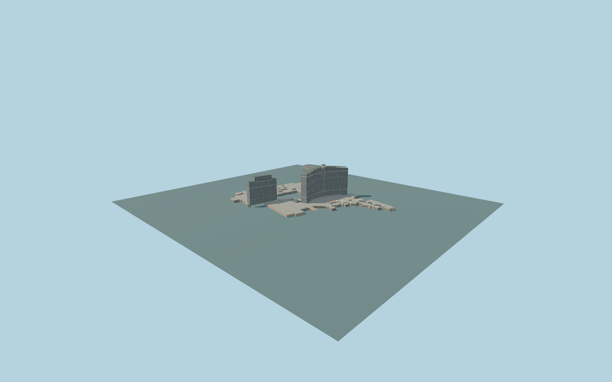

# Bellagio Hotel & Casino

Complete original Bellagio exterior: three curving main hotel wings with warm pale piers, dark window columns, a tall arched upper gallery and155m central open lantern; separate stepped Spa Tower with120m central green hip roof; whole low casino/convention complex, open pool courtyard, lakefront domed pavilions/terracotta arcades, southern low extension and an open green barrel-vaulted porte-cochere with raised clerestory.

Rebuild the original checked-in source with `node packages/worldgen/scripts/generate-bellagio.mjs`; append `--check` for exact bytes. Import and LOD commands select `--ids=bellagio_hotel_casino`. GLBs are ignored build outputs. The detailed source and four budgeted browser tiers remain separate.

The retained Q25007 resort, its open courtyard and actual tower/canopy/roof parts fix the plan. Heights, fine facade and roof inventories, southern low extension, hotel doorway and drive/site grades are original picture/map approximations, not as-built surveys. The fountain lake, water show, landscaping, interiors and neighboring hotels are outside this mesh. Six existing shared256px graphs are reused without private or embedded images; the green canopy is stylized opaque glazing. Full scope and limitations: model-brief.json and qa.json.

Original geometry uses the repository license. Maps: © OpenStreetMap contributors, ODbL-1.0; Protomaps. Terrain hashes and attribution: terrain-grid.json. Linked photographs are local reference only, not redistributed or used as textures.
