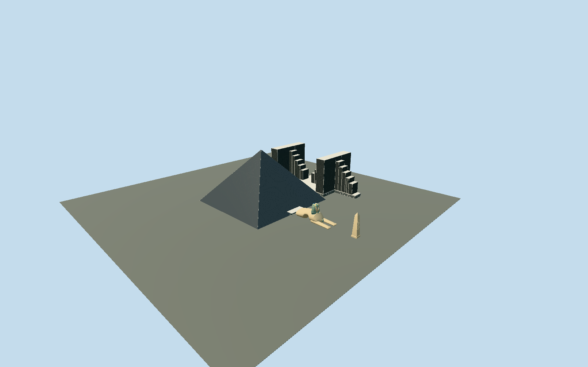

# Luxor Resort & Casino

The actual black-bronze glazed pyramid with fine pane courses, hip lighting rails and open apex lamp well; separately mapped twin stepped hotel wings; eastern sculpted lion-bodied Sphinx with striped nemes, almond eyes, cobra and beard; and the roadside Luxor obelisk.

## Evidence and reconstruction

Published dimensions and reconstructed details are separated in spec.json. Primary references:

- [Reference](https://www.tutorperini.com/projects/hospitality-gaming/luxor-las-vegas/)
- [Reference](https://www.skyscrapercenter.com/building/luxor-pyramid/13708)
- [Reference](https://luxor.mgmresorts.com/en/contact-us.html)
- [Reference](https://assets.contentstack.io/v3/assets/bltc6ce635bc4868eb2/blt5733301aa5cc771e/luxor-hotel-property-map.pdf)
- [Reference](https://filecache.mediaroom.com/mr5mr_mgmresorts/182111/download/Luxor%20Fact%20Sheet%202026.pdf)
- [Reference](https://www.deseret.com/1996/1/3/19218241/array-of-architectural-wonders-helps-statuemaker-gain-stature/)
- [Reference](https://www.openstreetmap.org/way/27858544)
- [Reference](https://www.openstreetmap.org/way/118344867)
- [Reference](https://www.openstreetmap.org/way/118344869)
- [Reference](https://www.openstreetmap.org/way/399368723)

No third-party geometry, photograph or bitmap texture is embedded. Shared surface graphs come from the central library; vertex tints carry model colors. Glazing uses PBR materials; transparent surfaces are declared per model.

## Model and axes

39,207 triangles; 92,683 vertices; 4 material groups; 3,809,908 bytes. Native bounds: -135.660, 0.000, -193.808 to 228.950, 106.710, 91.516. Source hash: `sha256:2196716d64340434591fc8ab2b1f614c8c0eb5a72091789dc9a6a6adca962d4b`.

{"up":"+Y","longAxis":"+X east to Sphinx and Strip obelisk","shortAxis":"+Z south; later twin wings lie north"}

Fresh2026-10-10 all27 exact original raw rings unchanged:Q637389 pyramid27858544,22northern hotel steps/connectingcasino136520122, eastern Sphinx body118344867/head118344869/canopy118344870 and Strip obelisk399368723. Preserved original anchor[-115.175804411,36.095470033], heading.006126645406 retain+X east to Sphinx/obelisk and+Z south, hotel wings north. Independently inspected contractor aerial and operator property casino/lower maps corroborate eastern entry/Sphinx and northern twin wings; raw relative coordinates sign both90/180degree square ambiguities.182.88m glassbase and106.68m published height retained;660ft contractor structuralbase and111m raw mapheight are distinct extents/facts. Independent Sphinx rawbody x99.26–178.17m/head x133.20–150.11m, mappedobelisk x218.91–228.65m register reconstructed body/head/obelisk; sculptural finecontours differ from projected rooftrace, accepted up to3m wholepart fit/2degree bearing allowance, not survey accuracy. Model uses maker110ft Sphinx and140ft obelisk, not62/70m mapobelisk tags. Hotel80m mapped crest with operator22floors and7.2m lowcasino roof reconstructed from exteriorphotos; map20m podium not literal groundroof. GroundY0 approximate sharedentranceapron, no measuredstreetgrade. No footprint replacement. Pools/plaza/garages/neighbors/tram/interiors and atmospheric beam excluded.

## Reproduce

Run `node packages/worldgen/scripts/generate-signature-towers.mjs --ids=luxor_resort_casino` (or add `--check`). The generator preserves manually edited masters by checking their baseline hashes. Import through the standard authored-model workflow with optimization disabled; then capture all QA cameras, including shared-surface views.

## Pending work

- Original buildLuxor remains unchanged and byte-reproduces271559triangles/25322528bytes. Separate reviewed source retains182.88m blackbronze glasspyramid,106.68m openlampwell/hip rails/apex edge housings, all22 mapped steppedhotel masses and lowconnectingcasino, east-facing sculpted lionbody with opentransversepassage/two long paws/individualtoe pads, head/almondcosmeticeyes/nose/ears/lips/stripednemes/beard/cobra, miniaturestatue, eastcanopy and42.67m roadsideobelisk/originalLUXORlineglyphs. Continuous glassplane plus projected60horizontalcourse strips/4.575m verticalbays replace dense1.525m pane mesh/repeatedclosedbeam shells. Towercourses3.3m retained as flatstrips; verticalbay3.2m replaces1.6m. Near sculpture uses32side/.45m face samples,36x6 headcloth sheet cells/12crownrows,32side two-subdivision longitudinal bodyrings,20side15length paw samples and20x10 minor ellipsoids; original96side/.15m face/72x14cloth/96side8subdivisionbody/64side45paw shape recipes preserved. Six-sided25lampheads replace original12/16sided heads. Near surface contour remains original Hermite/controlprofile reconstruction; painted bands stay vertexcolors, no copied photograph. Shared concrete graph also approximates paintedfoam sculpture/casino facade; opaque visionpalette approximatesglass; dark recesses share paintedmetal to stay atfour drawgroups. Skyline uses fourfaceted body rings/closed coarseheadcloth/head/beard, rectangularpaw silhouettes/simpleminiaturestatue and attachedcanopy withtwo supports; preservespassage/wholeparts, omits facecosmetics/nemesstripes/toes/glyphs/panelrhythm/lamps/hiprails; retainsopen apex edge housings and narrows smallpodiumjogs under1m. District restores wide glazingcourse rhythm, coarseoriginalobeliskglyphs, simpleblueeyes/projectingnose on coarseSphinx, omits stripedcloth/finefeatures/toes/paleverticalwingfascias. Street restores20pyramidcourses/9.15mbays,6.6mhotelcourses/6.4mbays and sculptedstripedmainSphinx but miniaturehead is a closedsimpleproxy. Close-up restores nearcadence/mainandminiaturesculpturalfeatures. Sculpture/wingheights/canopy/podiumrelativeelevations/doorandglyphpositions unsurveyed; physical-device/dense-city timings/globalerrorbounds unmeasured.

This bundle follows the medium-fi standard. Medium-fi appearance and geographic fit are reviewed separately. Hash-bound visual acceptance is recorded separately after capture inspection.
