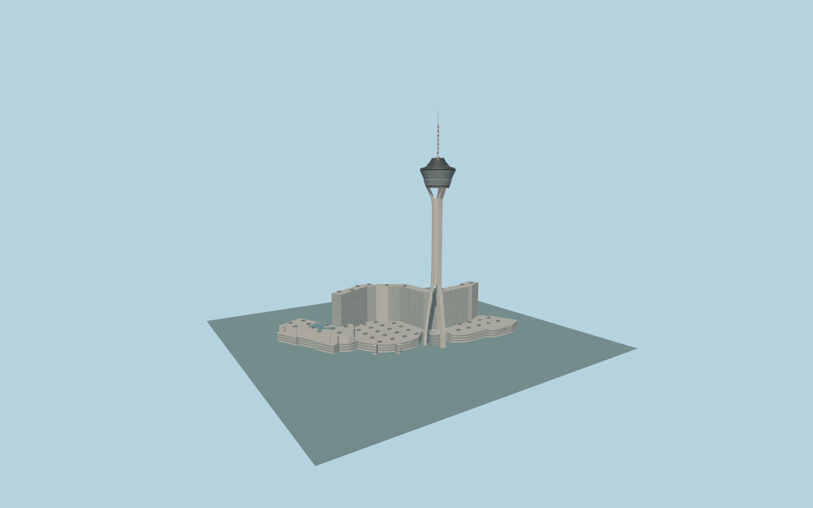

# The STRAT Hotel, Casino & SkyPod

Complete Las Vegas STRAT resort:350m three-buttress observation tower with real open leg/upper slots,dark sloping glazed pod and lower lattice cone,red-white mast,75m bent hotel slab with white floor bands,broad curved casino,pool wing and mapped rooftop pool.

Original source:models/strat-model.mjs,layout.json and attributed map/global-terrain controls. Rebuild with `node packages/worldgen/scripts/generate-strat-resort.mjs`;append `--check` for exact bytes. Import/LOD commands select `--ids=the_strat_hotel_casino_skypod`. GLBs are ignored outputs.

Five existing shared256px graphs plus palette pool water;no private or embedded images. Detailed master and four browser tiers are separate. This is the complete hotel/casino/tower exterior. The75m bent hotel court opens toward-Z/NW;the350m tower stands toward+Z/ESE/Las Vegas Boulevard. Three tapering supports preserve actual open gaps rather than a filled cylindrical tower. Pod lattice,sloping observation glazing,red-white mast and mapped pool support recognition. Casino14m and pool-wing24m heights,pod/leg sections,roof details and original site grades remain approximate. Adjacent25m parking garage remains native map content. See model-brief.json and qa.json for scope/current acceptance.

Original geometry uses the repository license. Maps:© OpenStreetMap contributors,ODbL-1.0;Protomaps. Raw global terrain hashes/attribution:terrain-grid.json. Linked ordinary pictures are not redistributed or used as textures.
