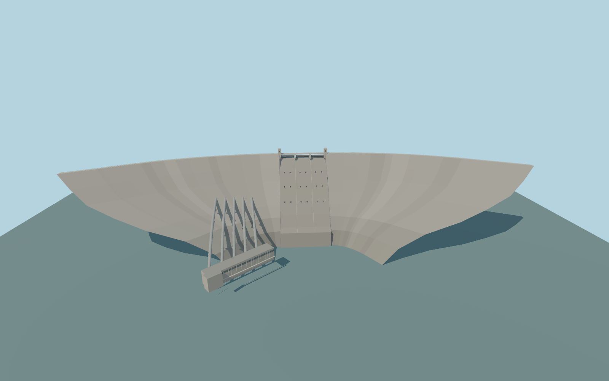

# Shasta Dam

Shasta Dam’s curved gravity section, three closed drum gates between two towers, eighteen recessed outlets, five sloped penstocks and the separately mapped powerhouse.

Rebuild: `node packages/worldgen/scripts/generate-shasta-dam.mjs`;append `--check` for exact source bytes. Select import/LOD/placement with `--ids=shasta_dam`. Detailed source and four browser tiers are separate ignored GLB outputs.

The signed vertical origin is 325.421875 m. The crest is fixed at 328.422 m and the foundation at 144.9324 m. The design fixture uses 325.2216 m normal full pool and a representative 179.7 m downstream stage.

The 918.89 m mapped crest road controls the open portion. The end ties extend the concrete crest to 1,052.44 m, within about 2.2 m of the 1,054.61 m documented length. Wing and apron sections and outlet elevations are photo-based exterior approximations.

The standard terrain gives 326.07 m upstream and 180.37 m downstream. The narrow central cut keeps native rock shoulders intact. Small terrain intersections can remain at the bank transitions.

The powerhouse follows its mapped footprint and the penstocks terminate at the upstream wall. Interior machinery, the separate switchyard and flowing water are outside the asset.

Original geometry:repository license. Map:© OpenStreetMap contributors,ODbL-1.0;Protomaps. Standard terrain:terrain-grid.json. Ordinary pictures stay local and are not redistributed or used as textures. Current acceptance:qa.json.
