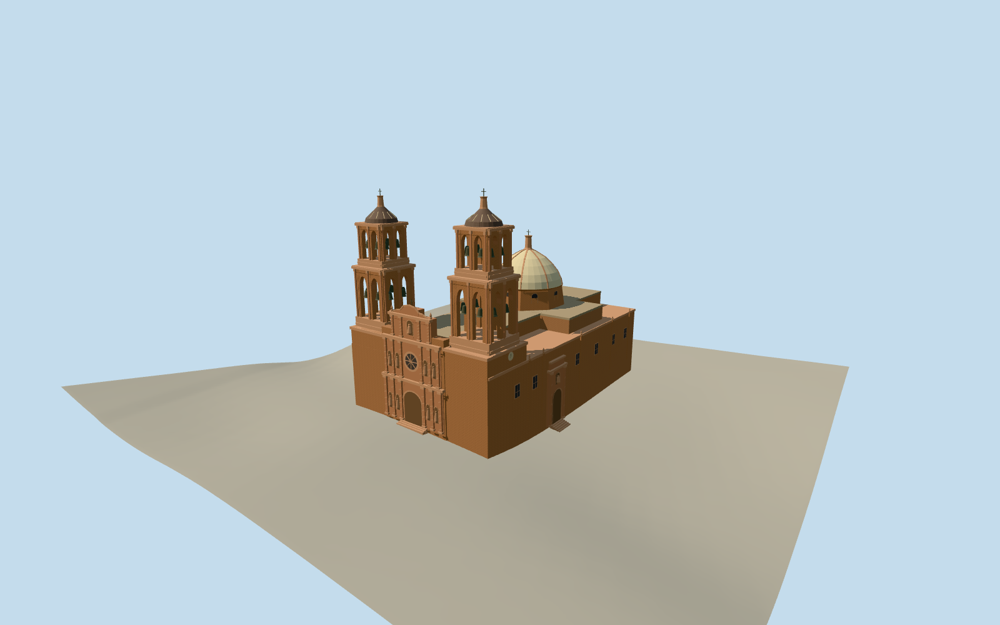

# Cathedral Basilica of Zacatecas

Rose cantera cathedral basilica with carved west front, two open belfries, three-aisle massing and cream crossing dome.

Authoring state: **review-in-qa.json**. Current completion evidence is in [qa.json](qa.json) and the [completion ledger](../../../../qualla-structures/batches/qualla-003.PROGRESS.md).

- [Cathedral Basilica of Zacatecas](https://qualla.com/cathedral-basilica-of-zacatecas/)

The main footprint, 45-meter height, two-stage belfries, three-part west front and octagonal crossing drum are documented. The nave section, roof forms, individual tower dimensions and stone ornament are proportional estimates.

The Qualla photograph has conflicting 2007 EXIF and 2009 description dates. The model uses the late-2000s exterior corroborated by independent 2008 photographs.

The 128-meter elevation field is unchanged. The west threshold and side steps follow approximate original provider grade. Interiors, individual statuary identities and the separately mapped parish house are outside scope.

Build: `node content/worldgen/source/places/9s/9sp/cathedral_basilica_of_zacatecas/models/generate-cathedral.mjs`. Add `--check` to verify exact regeneration. 12862 triangles; 6 materials; no embedded photographs.
