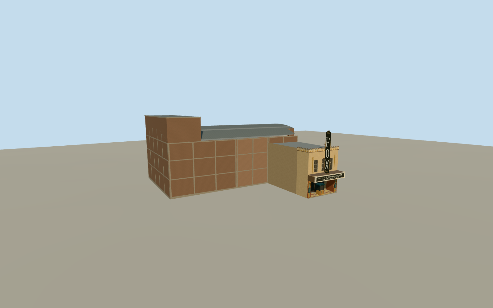

# Fox Tucson Theatre

The historic Tucson theatre with its FOX blade, tiled Art Deco entrance, rectangular marquee, west fly loft and curved auditorium roof.

Authoring state: **review-in-qa.json**. Current completion evidence is in [qa.json](qa.json) and the [completion ledger](../../../../qualla-structures/batches/qualla-003.PROGRESS.md).

- [Fox Tucson Theatre](https://qualla.com/fox-tucson-theatre/)

The February 2012 originals control the Congress Street entrance, replica signs, coping and ticket booth. Individual sign flourishes, lettering construction and tilework are simplified.

The curved auditorium roof and west fly loft follow the National Register description. Their heights and unpictured service elevations are approximate. The separate adjacent shops and later expansion are outside the modeled theatre scope.

The elevation field is unchanged. Pavement contact is approximate and is sampled from the original terrain.

Build: `node content/worldgen/source/places/9t/9t9/fox_tucson_theatre/models/generate-fox-tucson-theatre.mjs`. Add `--check` to verify exact regeneration. 3066 triangles; 7 materials; no embedded photographs.
