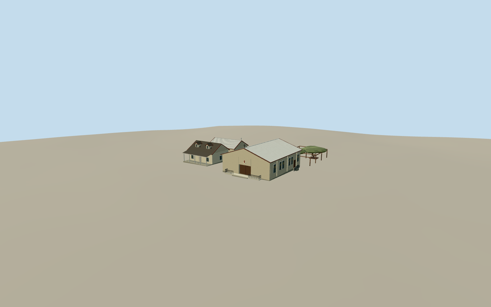

# Sacred Heart Church, Tombstone

Three historic Sacred Heart parish buildings and the timber rose trellis on East Safford Street in Tombstone.

Authoring state: **review-in-qa.json**. Current completion evidence is in [qa.json](qa.json) and the [completion ledger](../../../../qualla-structures/batches/qualla-003.PROGRESS.md).

- [Sacred Heart Church (Tombstone, Arizona)](https://qualla.com/sacred-heart-church-tombstone-arizona/)

The March 2015 photos establish the 1947 and 1881 street fronts, the 1882 hall entrance, and the rose trellis. Exact window tracery, decorative detail and rear openings remain approximate.

The 1882 hall and side additions share an irregular mapped outline. Their roof joint, kitchen openings and minor details are reconstructed from the mapped mass and the parish description.

Original elevations are unchanged. Individual thresholds, the low approach ramp and the rose beds use approximate contact with the composite source field.

Build: `node content/worldgen/source/places/9t/9t9/sacred_heart_church_tombstone_arizona/models/generate-sacred-heart-tombstone.mjs`. Add `--check` to verify exact regeneration. 5744 triangles; 7 materials; no embedded photographs.
