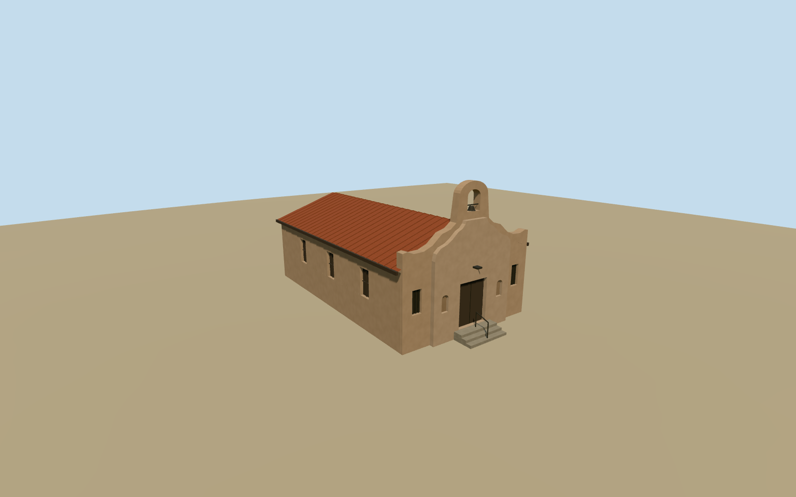

# San Pedro Chapel

Tucson’s standing Mission Revival adobe chapel with a shaped northern parapet, open bell arch, and small red-tiled nave.

Authoring state: **review-in-qa.json**. Current completion evidence is in [qa.json](qa.json) and the [completion ledger](../../../../qualla-structures/batches/qualla-004.PROGRESS.md).

- [San Pedro Chapel](https://qualla.com/san-pedro-chapel/)

The exterior represents the standing chapel as photographed in 2012. Earlier chapels, separate grounds buildings and interior fixtures are outside the selected scope.

The measured 8.53 by 14.63 metre adobe shell is centered and oriented on the generalized map polygon, which is about 10.9 metres wide. Parapet and roof heights and trim dimensions are estimated from the north and northeast photographs.

The original public elevation field is retained. Grade against the lower adobe and foundation is approximate, especially across the west patio.

Build: `node content/worldgen/source/places/9t/9t9/san_pedro_chapel/models/generate-san-pedro-chapel.mjs`. Add `--check` to verify exact regeneration. 1276 triangles; 5 materials; no embedded photographs.
