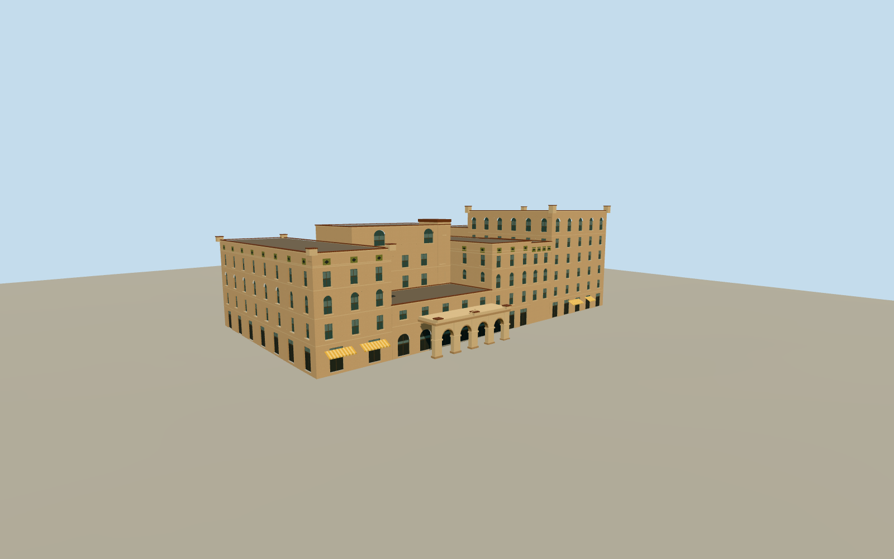

# Santa Rita Hotel

The former Santa Rita Hotel in Tucson, with its Mission Revival entrance arcade, decorated parapets, and 1917 south wing.

Authoring state: **review-in-qa.json**. Current completion evidence is in [qa.json](qa.json) and the [completion ledger](../../../../qualla-structures/batches/qualla-003.PROGRESS.md).

- [Santa Rita Hotel](https://qualla.com/santa-rita-hotel/)

The model represents the original hotel after the 1917 addition, visually dated to approximately 1937. It is available through the historical viewing date. The original hotel was demolished in the 1970s.

Map registration uses modern street control and estimates of the historic curb-to-centerline distances. The original hotel terrain is represented by unmodified present-day public elevation data.

The north and west facades follow the archive postcard. Rear elevations, precise floor heights, concealed roofs and arcade ornament are reconstructed approximately. The project covers the exterior, including the porch voids.

Build: `node content/worldgen/source/places/9t/9t9/santa_rita_hotel/models/generate-santa-rita-hotel.mjs`. Add `--check` to verify exact regeneration. 13748 triangles; 5 materials; no embedded photographs.
