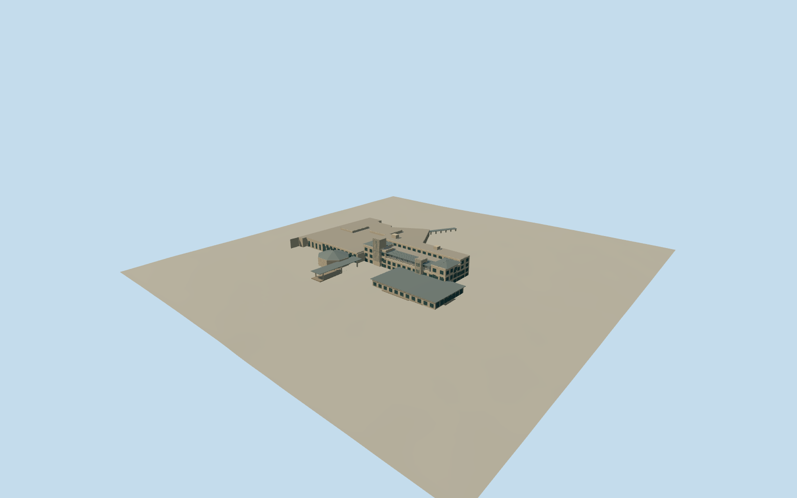

# Arizona Biltmore Hotel

Historic main block with stepped textile-block tower, recessed upper veranda, long room bar, low Gold/Grand wings, octagonal copper-roofed Aztec Room and open entrance canopy.

Authoring state: **review-in-qa.json**. Current completion evidence is in [qa.json](qa.json) and the [local 100 ledger](../../../../qualla-structures/batches/PROGRESS.md).

- [Arizona Biltmore Hotel](https://qualla.com/arizona-biltmore-hotel/)

Original medium-fi main-block exterior from individually inspected Qualla photos, architect-published 1929 plans and official 2024 resort map. Not a survey or photogrammetric reconstruction.

Current restored main building only. Later East/Garden/Paradise/Valley/Ocatilla wings, separate conference halls, cottages, villas, pools and broader grounds are excluded. Connected boundary clipping is an explicit scope decision.

Upper-room setbacks, heights, service-side roofs and exact window positions are photo-derived approximations. Original plans guide massing but do not claim that every 1929 interior survives.

Geometric textile-block relief uses the published 18 by 13.5 inch module with a simplified original stepped-leaf motif, not a replica of the exact mold. No photographic pixels, readable signage or interiors are embedded.

Independent terrain rises across the footprint and is not flattened; the foundation extends below the south approach datum. Another host DEM can change exact ground contact.

Build: `node packages/worldgen/scripts/generate-authored-places.mjs --ids=arizona_biltmore`. Add `--check` to verify exact regeneration. 60176 triangles; 5 materials; no embedded photographs.
