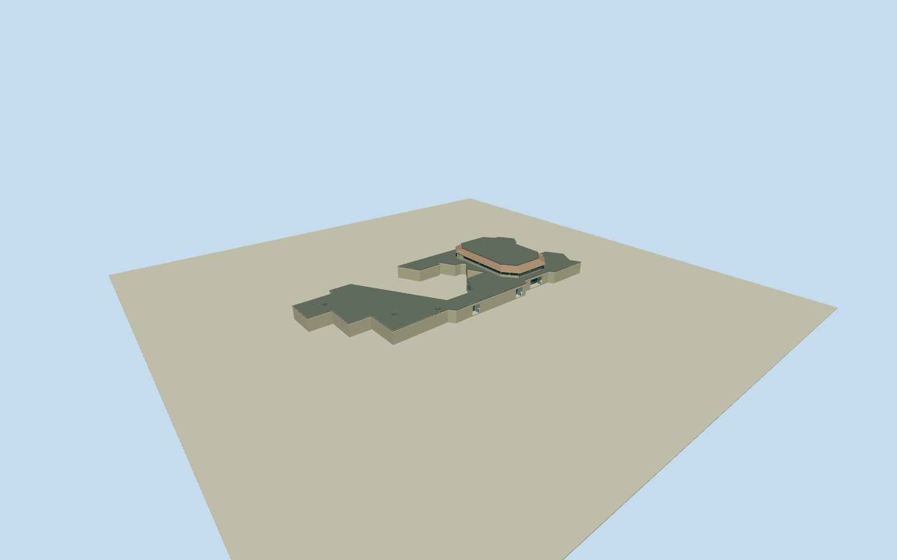

# Chamizal National Memorial Cultural Center

Complete connected Chamizal Cultural Center/Visitor Center exterior on original42vertexC-shaped plan: open northwest innercourt, low faceted stone wings/deep open covered portals and recessed closed entry glazing, separately raised theatre volume with shadowed clerestory/white short supports/broad brown sloping faceted fascia/dark flat roofcap/tall stone end fins. Whole native building extent; photograph-interpreted roof/height/door subdivisions. No park/sitepavement/murals/sculptures/detachedfacilities/interior.

Authoring state: **review-in-qa.json**. Current completion evidence is in [qa.json](qa.json) and the [completion ledger](../../../../qualla-structures/batches/qualla-002.PROGRESS.md).

- [The River That Moved a Border](https://qualla.com/chamizal-national-memorial/)

Exact named ChamizalN.M.VisitorCenterway249044427/800SouthSanMarcialStreetfixes the actual connected CulturalCenter/VisitorCenter exterior. Original42vertexC-shaped native envelope retained unchanged, meananchor[-106.45409388095239,31.767941445238097], cardinalframe. This is a building plan, not55acrememorialgrounds or a park/storycentroid. Broad west/northwest courtyard notch stays open. No native height/roofpartition supplied; multiple roof levels, raised theatre cap/fascia and shadowed porticos are bounded interpretations of the exact NPSexterior, not all plan area uniformly extruded or a certified roof survey. Exactdoor/hiddensection/mural-wall/terraincontact unverified.

Whole named connected cultural center exterior only: museum/gallery/lobby/theatre and attached wings with original open northwest Ccourt/recesses. The central raised theatre section, roof partition/6–9mheight/clerestory/fin positions, entry/portico distribution and concealed rear elevations are bounded interpretations from one cleared NPSexterior, not surveyed roof or engineering replica. Main footprint remains original; innercourt is not extruded or paved.

Exact already-published3072x2048QuallaNPSstaff2003exterior/nativeSHA1was inspected first; byte-identical primaryNPGalleryoriginal/explicit staff/public-domain release is the accepted control. Shared procedural stone/painted-metal/roof and muted glazing only, no copied pixels/generated bitmap. Unknown-author/attribution-licensed photographs, modern mural/sculptureartwork, performance/poster/interior/people imagery excluded. Current cosmetic condition and later concealed changes unverified.

No55acrememorial grounds, esplanade/landscape/courtyardpavement/roads, detached administration/pavilions/outdoorstage, murals/sculpture/lettering, interiors/furniture/performers/people/vehicles. Own covered portals and short endfins are part of building; no invented park slab or artwork.

Original160mTerrariumgrid/rawtiles/heightPNGretained unchanged at fixed innercourt[-14,0]. Exact plaza threshold/stonegrade and hostterraincontact remain unverified. Mapped roof-edge/wall correspondence and proposed source sections remain approximate; replaceFootprint=false.

Build: `node packages/worldgen/scripts/generate-authored-places.mjs --ids=chamizal_cultural_center`. Add `--check` to verify exact regeneration. 1740 triangles; 5 materials; no embedded photographs.
