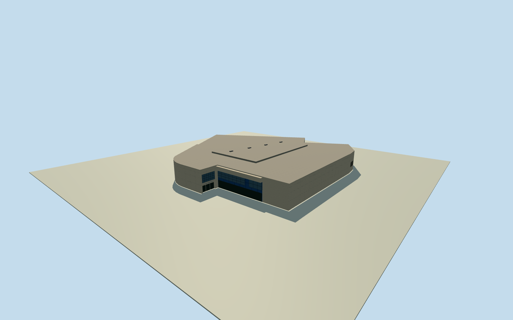

# El Paso Museum of Art

Two-storey museum with a pale paneled exterior, a recessed plaza entrance, adjoining blue panels and dark glazing, and an angled gallery plan.

Authoring state: **review-in-qa.json**. Current completion evidence is in [qa.json](qa.json) and the [completion ledger](../../../../qualla-structures/batches/qualla-003.PROGRESS.md).

- [Renaissance Masters in the Desert](https://qualla.com/el-paso-museum-of-art/)

The exact published public-domain Qualla exterior is dated to 2011. It establishes the pale panel grid, paired glazed entry doors, tall mullioned window, blue side wall and pale overhang.

The mapped perimeter fixes the entire gallery footprint. Roof plan, unseen secondary elevations and precise opening sizes and heights are estimates. Artworks, nearby buildings and reflections are outside scope.

The original 128 m elevation field remains unchanged. Its plaza contact establishes the approximate entrance grade. The rear walls meet rising terrain without flattening the field.

This is a dated 2011 exterior with no source-image pixels or modern alterations.

Build: `node content/worldgen/source/places/9t/9ts/el_paso_museum_of_art/models/generate-house.mjs`. Add `--check` to verify exact regeneration. 1068 triangles; 5 materials; no embedded photographs.
