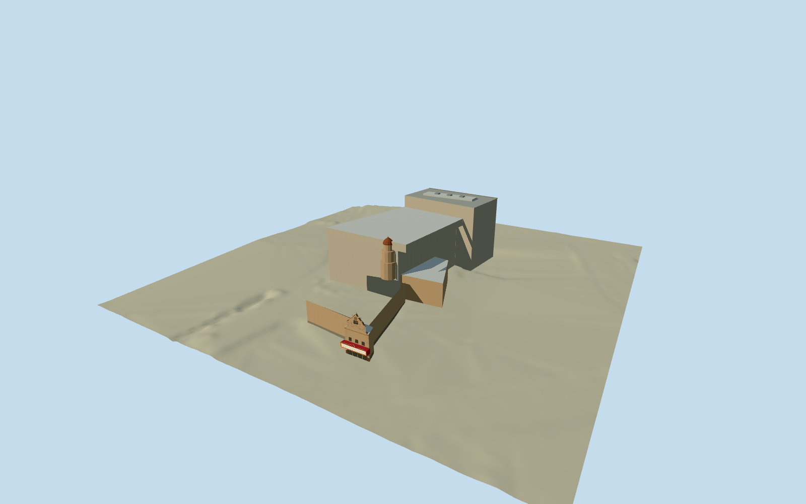

# Plaza Theatre (El Paso)

The Spanish Colonial Revival Plaza Theatre in El Paso, with its scrolled stucco gable, mosaic balcony, decorated marquee, auditorium and tall stage house.

Authoring state: **review-in-qa.json**. Current completion evidence is in [qa.json](qa.json) and the [completion ledger](../../../../qualla-structures/batches/qualla-004.PROGRESS.md).

- [Plaza Theatre (El Paso)](https://qualla.com/plaza-theatre-el-paso/)

OpenStreetMap and the USDA orthophoto establish the extents. Main heights, the secondary roof equipment and rear opening details are estimated.

The marquee’s decorative pattern and lettering are model geometry. The message board is unlettered and the interior is outside the scope.

The connected Centre Building and adjacent Art Museum are separate structures.

Build: `node content/worldgen/source/places/9t/9ts/plaza_theatre_el_paso/models/generate-plaza-theatre-el-paso.mjs`. Add `--check` to verify exact regeneration. 4384 triangles; 8 materials; no embedded photographs.
