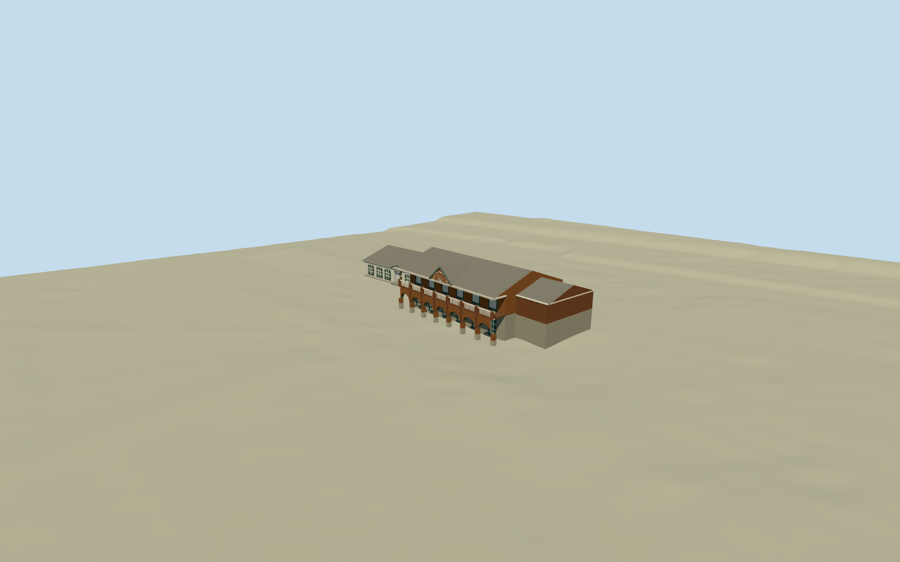

# Fort Stanton (New Mexico)

Fort Stanton’s two parade-ground guardhouses, including the former Adjutant’s Office and Library.

Authoring state: **review-in-qa.json**. Current completion evidence is in [qa.json](qa.json) and the [completion ledger](../../../../qualla-structures/batches/qualla-004.PROGRESS.md).

- [Fort Stanton: From Apache Wars to Snowy River Cave](https://qualla.com/fort-stanton-new-mexico/)

The two standing south-parade buildings are represented. Rear elevations, roof pitches and small trim lengths are visual estimates.

The parade-ground landscape, barracks, officers’ quarters, other outbuildings and interiors are outside this model.

Build: `node content/worldgen/source/places/9t/9tu/fort_stanton_new_mexico/models/generate-fort-stanton-new-mexico.mjs`. Add `--check` to verify exact regeneration. 4645 triangles; 6 materials; no embedded photographs.
