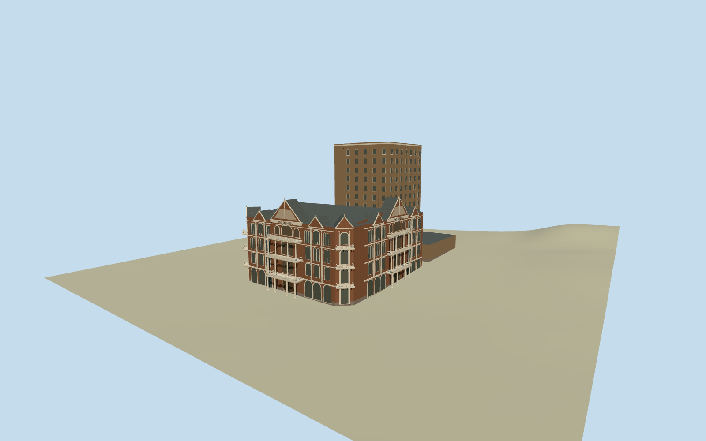

# Driskill Hotel

The 1886 brick and limestone Driskill, with gabled loggias and its taller historic Seventh Street annex.

Authoring state: **review-in-qa.json**. Current completion evidence is in [qa.json](qa.json) and the [completion ledger](../../../../qualla-structures/batches/qualla-004.PROGRESS.md).

- [Driskill Hotel](https://qualla.com/driskill-hotel/)

Exact stone carvings, some side fenestration, annex upper setbacks and small later Seventh Street entrance changes are approximate.

Build: `node content/worldgen/source/places/9v/9v6/driskill_hotel/models/generate-driskill-hotel.mjs`. Add `--check` to verify exact regeneration. 15390 triangles; 7 materials; no embedded photographs.
