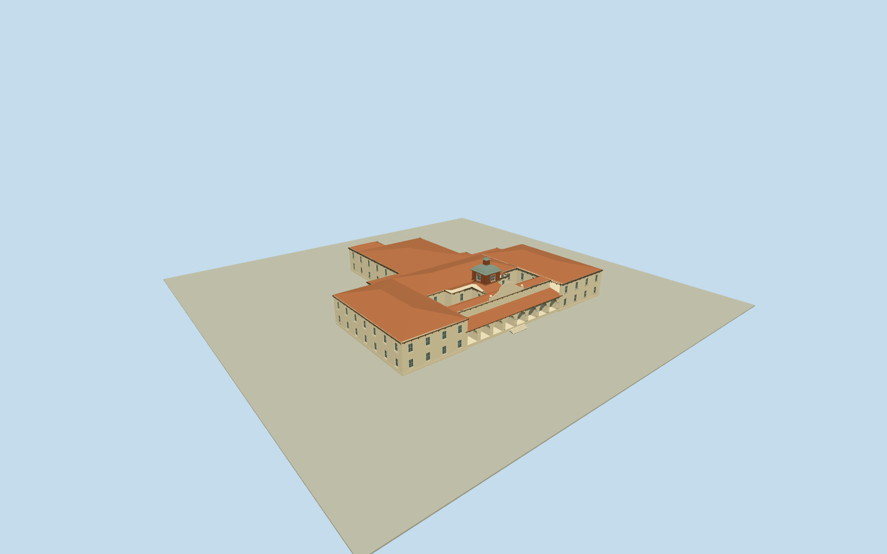

# Fort Worth Livestock Exchange Building

Whole originalT-shaped LivestockExchangeBuilding and BOTHopeninnercourtyards: creamstucco/terracotta hippedroofs/broad eaves, genuineeight-bay southfront arcade and recessedclosedentries, centraltallMissioncurvedsteppedparapet/ballfinials, shingledsquarecupola/archedlights/bellcastpatinatedroof/louvredlantern/cap/finial; connectedrearwing. No district slab/pens/detachedlandmarks/artwork/lettering/interiors.

Authoring state: **review-in-qa.json**. Current completion evidence is in [qa.json](qa.json) and the [completion ledger](../../../../qualla-structures/batches/qualla-002.PROGRESS.md).

- [Fort Worth Stockyards](https://qualla.com/stockyards-fort-worth/)
- [Fort Worth Stockyards](https://qualla.com/fort-worth-stockyards/)

Exact LivestockExchangeBuildingnode4273376249and StockyardsMuseumnode368165552at131EastExchangeAvenue identify original buildingmultipolygonrelation7321195: full21vertexouterway56029794and both6vertexinternalcourtyardholes499180510/499180511. OriginalT-shaped rearwing and long south/frontblock, approximately70x65moverall, retained unchanged; neither courtyard is a separate building or filled roof/site slab. Fixed cardinal east/south frame anchored at original outerbboxcenter[-97.34672710000001,32.78952875]. Southfront architecture from acceptedHighsmithphotos; map has no heights/roof partitions. Exact arcade depth/bay census/rear roofing/vertical sections hidden and bounded estimates. Distinct CowtownColiseumway56029797and other districtstructures excluded.

Whole survivingExchangeBuilding only, originalT-shaped21vertexouterenvelope and both6vertexcourtyardholes preserved. Mainfrontarcade modeled as eight genuinely open bays with coveredrecesses/closedentries; exactbaycensus/roofpartitions/hiddenrear elevations/courtyardsash/sections/heights are bounded interpretations of two frontHighsmithphotos and native plan. Nearer roofs use explicit planar hip sections clipped to the full original perforated plan, with genuinecourtyardholes and closed boundary faces. Skyline approximates these roof sections within2.2m. No rooforcampusslab fills courts.

Two exact primaryHighsmithnativeJP2photographs actually inspected via lossless full-sizeddecodes, bound to individualLOCcatalog/photographer public-domain dedication. Qualla inventory inspected first; oldstockpen/packingplant postcards do not establish this Exchangeexterior and are unused. No copied image pixels or generatedbitmap. Source wall/roof/shingle/metal hues support exterior; moderncosmetics/hiddenchanges unverified.

Missioncurvedparapet/ballfinials, paleopenarcade/raisedentry and shingledarched-windowcupola/bellcastgreenroof/louvredlantern represented. Lettering/mountedlonghorn-headartwork/flags/flagpole omitted. Sharedproceduralstucco/terracottatile/cedarshingle/paintedmetal, muted glazing and original geometric relief only; no engineeringreplica claim.

No entireStockyardsdistrict/cattlepens, detachedCowtownColiseum/StockyardsHotel/station/barns, roads/plazas/parking/landscape/statues, interiors/animals/people/cars or demolishedpackingplant. Original160mterrain/rawtile/grid/PNG frozen unchanged at fixed[0,36]. Exact sill/arcadefloor/hostcontact unverified; replaceFootprint=false.

Build: `node packages/worldgen/scripts/generate-authored-places.mjs --ids=fort_worth_livestock_exchange`. Add `--check` to verify exact regeneration. 14473 triangles; 7 materials; no embedded photographs.
