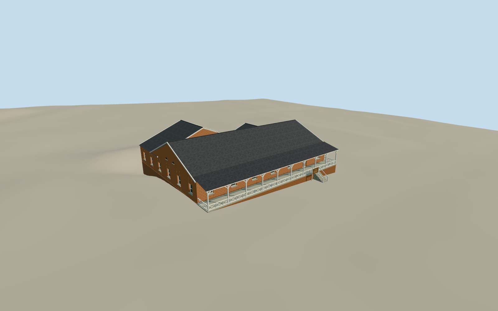

# Fort Douglas Museum

Fort Douglas Military Museum’s main 1870s barrack on Potter Street, with red sandstone, dark gable roofs and a white timber veranda in May 2022.

Authoring state: **review-in-qa.json**. Current completion evidence is in [qa.json](qa.json) and the [completion ledger](../../../../qualla-structures/batches/qualla-003.PROGRESS.md).

- [Fort Douglas](https://qualla.com/fort-douglas/)

This is the Ezekiel R. Dumke Jr. main museum gallery at 1990 East Potter Street. The adjacent Kauffman barrack and the remainder of the fort are separate buildings.

Map geometry controls the exterior plan. Roof pitch, rear openings, porch floor height, sign lettering and weathered sandstone tones are estimated from the documented building and the street photograph.

Original public terrain was preserved. Step height and the masonry meeting the ground are approximate.

Build: `node content/worldgen/source/places/9x/9x0/fort_douglas_museum/models/generate-fort-douglas-museum.mjs`. Add `--check` to verify exact regeneration. 6540 triangles; 6 materials; no embedded photographs.
