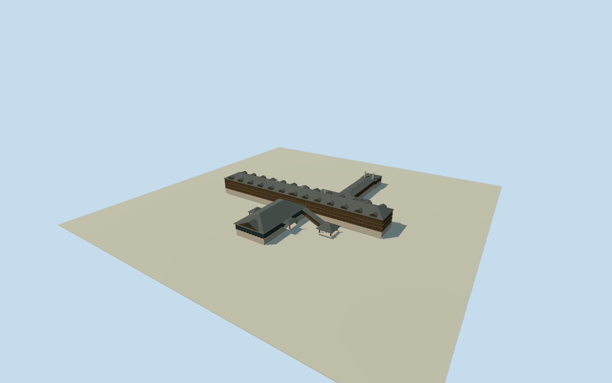

# Canyon Hotel, Yellowstone (1911)

Complete1911Reamer Canyon Hotel:595ft horizontal guest-room range incorporating the earlier1891hotel wing, central lobby,200x100ft south lounge with two side porches, north dining room175x60ft/south bow50x20ft,190x50ft north kitchen and further laundry, sloping entrance arcade and porte-cochere. Hidden wing integration/rear layout/heights/facing/grade are explicit estimates from original front image and primary topology, not an archival measured floorplan. Later1930addition and detached buildings/modern CanyonLodge excluded by1911date.

Authoring state: **review-in-qa.json**. Current completion evidence is in [qa.json](qa.json) and the [completion ledger](../../../../qualla-structures/batches/qualla-002.PROGRESS.md).

- [Canyon Hotel](https://qualla.com/canyon-hotel/)

Complete1911Reamer Canyon Hotel:595ft horizontal guest-room range incorporating the earlier1891hotel wing, central lobby,200x100ft south lounge with two side porches, north dining room175x60ft/south bow50x20ft,190x50ft north kitchen and further laundry, sloping entrance arcade and porte-cochere. Hidden wing integration/rear layout/heights/facing/grade are explicit estimates from original front image and primary topology, not an archival measured floorplan. Later1930addition and detached buildings/modern CanyonLodge excluded by1911date.

Independent512m129x129 original field/16641heights/four raw Terrarium tiles/frame/datum frozen before floor and main dimensions. Main floor original-field sample at[0,-8]+1.2m; lounge floor0.9m below lobby, port-road landing retains original datum. Long ranges have fixed horizontal floor and floor-count estimates, stepped/exposed basements on the historical downslope. Current composite terrain and approximate historical registration do not establish1911grade. Do not flatten/reacquire/reframe/move floors/main sections to improve views.

Original1911whole hotel at opening; excludes1930addition and modern CanyonLodge/corrals. Exact photographed finish/date uncertain within original1911publication; roof/window rhythms are simplified.

595ft overall range/200x100ftlounge/175x60ftdining/50x20ftbay/190x50ftkitchen are primary scalar dimensions; wall thickness/height/hidden rear layout/laundry/porches/arcade/basements/dormer count/old-wing integration are estimates. No surveyed floorplan claim.

Original monochrome publication supplies visible front roof/dormer/window morphology. Dark brown/red-stained wood, gray roof, pale foundations and clear dark glazing are bounded color interpretation, no photo textures.

Historic point/bearing approximate±100m/25degrees; native terrain is current composite and not1911ground. Historical footprint openings reveal physical basement extents only; source heights unchanged; no host contact certificate.

Whole intrinsic named hotel modeled; no detached stables/roads/natural hills/trees/people/interior furnishings or modern replacement included.

Build: `node content/worldgen/source/places/9x/9xc/canyon_hotel/models/generate-canyon-hotel.mjs`. Add `--check` to verify exact regeneration. 24915 triangles; 5 materials; no embedded photographs.
