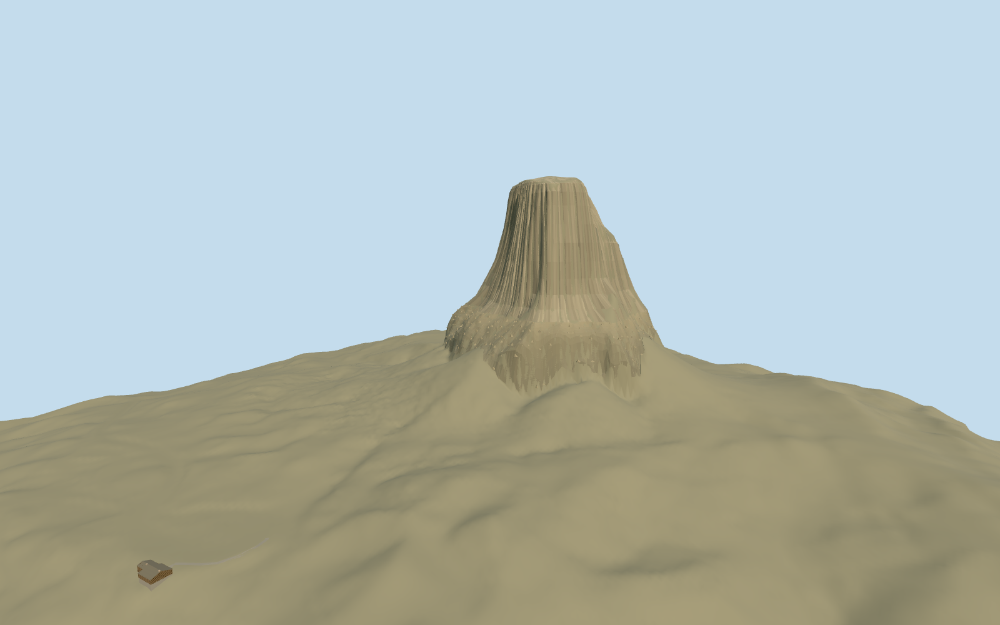

# Devils Tower National Monument

Devils Tower / Bear Lodge above its open talus, with a flat-crested fluted phonolite shaft and the historic log visitor center near the west approach.

Authoring state: **review-in-qa.json**. Current completion evidence is in [qa.json](qa.json) and the [completion ledger](../../../../qualla-structures/batches/qualla-003.PROGRESS.md).

- [Devils Tower National Monument](https://qualla.com/devils-tower-national-monument/)

USGS 3DEP determines the plan contour, summit relief and height. Individual column facets, ledge breaks, weathered colors and loose rocks are photographic or geological estimates.

The bare-rock perimeter bounds the terrain opening. The model reproduces the original elevation apron inside that perimeter and retains the original unmasked terrain field for comparison.

The original mapped Visitor Center footprint and east approach are retained. Chimneys, log diameters, foundation contact and unseen elevations are estimated.

Build: `node content/worldgen/source/places/9x/9xv/devils_tower_national_monument/models/generate-devils-tower-national-monument.mjs`. Add `--check` to verify exact regeneration. 24237 triangles; 6 materials; no embedded photographs.
