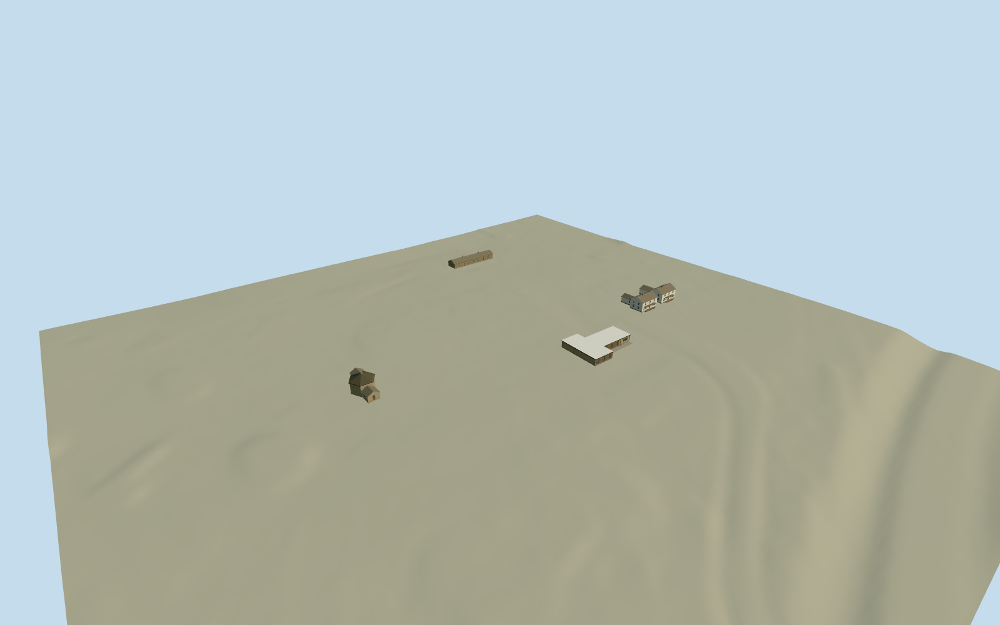

# Fort Hays

Fort Hays State Historic Site, with the limestone blockhouse and guardhouse, two officers houses and visitor center.

Authoring state: **review-in-qa.json**. Current completion evidence is in [qa.json](qa.json) and the [completion ledger](../../../../qualla-structures/batches/qualla-004.PROGRESS.md).

- [Fort Hays](https://qualla.com/fort-hays/)

Wall heights, minor apertures and fine timber decoration were proportioned using the documented building types. The historic floor plans and interiors are outside the current model scope.

All five present buildings are represented. The many removed post structures remain absent.

Build: `node content/worldgen/source/places/9y/9yc/fort_hays/models/generate-fort-hays.mjs`. Add `--check` to verify exact regeneration. 7179 triangles; 7 materials; no embedded photographs.
