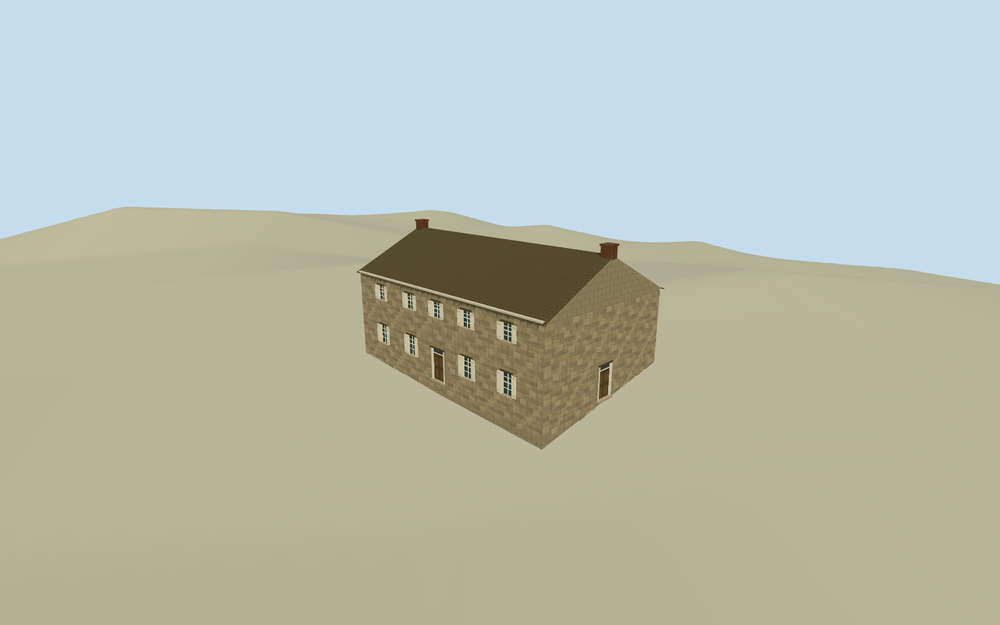

# First Territorial Capitol of Kansas

The restored First Territorial Capitol at Pawnee, with two storeys of limestone, shuttered sash windows, a gabled shake roof and two brick chimneys.

Authoring state: **review-in-qa.json**. Current completion evidence is in [qa.json](qa.json) and the [completion ledger](../../../../qualla-structures/batches/qualla-004.PROGRESS.md).

- [Fort Riley](https://qualla.com/fort-riley/)

The present map outline controls the geometry. Its long side is shorter than the approximate length listed in the 1965 historic survey.

Door and shutter profiles, chimney height, stone block pattern and surviving sill details are interpreted. Scope is the capitol exterior.

Build: `node content/worldgen/source/places/9y/9yg/first_territorial_capitol_of_kansas/models/generate-first-territorial-capitol-of-kansas.mjs`. Add `--check` to verify exact regeneration. 19634 triangles; 6 materials; no embedded photographs.
