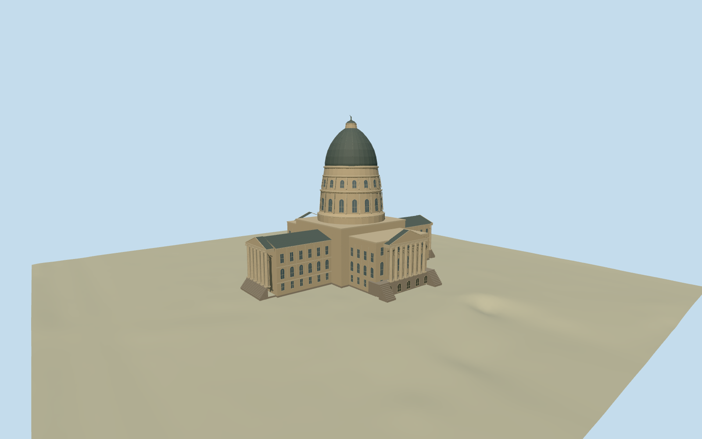

# Kansas State Capitol

The Kansas State Capitol in Topeka, with its limestone wings, classical colonnades and copper dome.

Authoring state: **review-in-qa.json**. Current completion evidence is in [qa.json](qa.json) and the [completion ledger](../../../../qualla-structures/batches/qualla-004.PROGRESS.md).

- [Kansas State Capitol](https://qualla.com/kansas-state-capitol/)

Standing exterior including attached entry levels. Grounds, gardens and interior spaces lie outside scope.

Unpublished detail heights and small roof ornament are estimated. The contemporary rooftop figure is represented as a distant silhouette.

Build: `node content/worldgen/source/places/9y/9yg/kansas_state_capitol/models/generate-kansas-state-capitol.mjs`. Add `--check` to verify exact regeneration. 22815 triangles; 6 materials; no embedded photographs.
