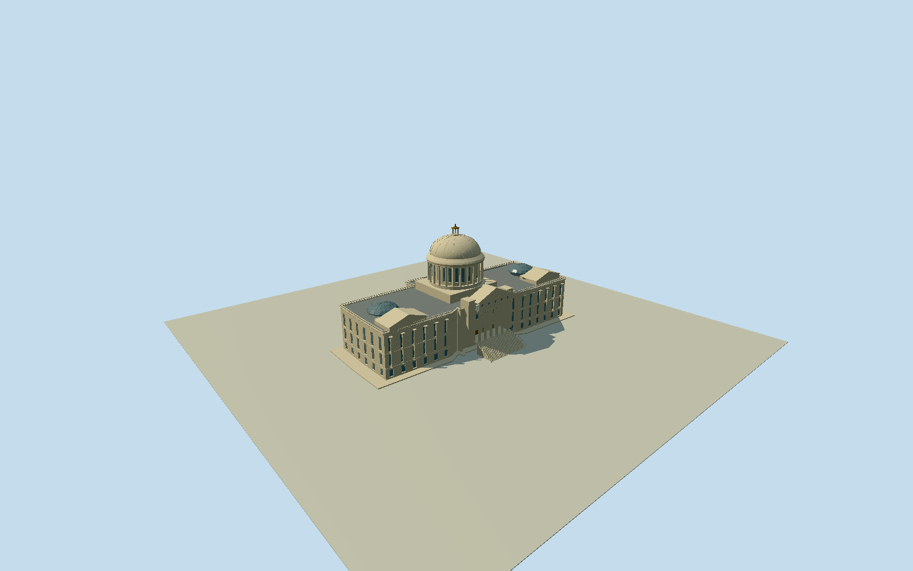

# Arkansas State Capitol

Whole ArkansasStateCapitol with native30control lowpodium and official134.112x59.7408m mainbody/64.9224m cupola, both long limestonewings/physicalwindowrecesses/giantcolumns/entablature/roofbalustrades/endpavilions/roofskylights, sixIoniccolumn mainportico/three closedbronzedoors/upperoculi/pediment/flankingblocks/broadintrinsicstairs, circularperistyledrum/closedopaquewindows/ribbedpaleIndiana-limestone dome/openlantern/gildedcapandball. Two exactpublished2021DsduganCC0 front originals; officialdimensions factual only. Native envelope/podiuminterpretation/hiddenrear/roof/domecentre/census/sections currentfinefinish estimated. No copied glassart/crests/inscriptions/sculpture/flags/lamps/grounds/interior/photo pixels; mainstone dome stayspale.

Authoring state: **review-in-qa.json**. Current completion evidence is in [qa.json](qa.json) and the [completion ledger](../../../../qualla-structures/batches/qualla-002.PROGRESS.md).

- [Arkansas State Capitol](https://qualla.com/arkansas-state-capitol/)

Whole actual nativeArkansasStateCapitol building97759549/Q673076 closed31point ring/thirtyunique controls, exactbboxanchor/heading0/+Xeast/+Zsouth; roadsnamedStateCapitol/CapitolMall are distinct from building. Whole slightlyskewed long north-south wings/mainbody/projectingfront retained. Dome/drum/sections/portico depths/pavilionrooflanterns/stairprofile/windowcensus are original photographic estimates after independentfieldfreeze, not a survey. Official2025SecretaryofState dimensions134.112mN-S/59.7408mE-W/64.9224m cupola control mainbody/height. Larger native148.344x69.279m envelope retained as original lowpodium; mapping-versus-podiummargin interpretation unresolved, not asserted survey.

All sourcefloors/sections/geometry follow immutableoriginal600m129x12916641sample/one rawtile/fixedSW101.7668m providerrelative fieldfreeze. OfficialArkansasSecretaryofState2025tourbook:440ftN-S/196ftE-W/213ftground-to-cupola (134.112/59.7408/64.9224m), limestonewall/dome/gildedlanterncap-ball. Exactnative30control148.34x69.28m envelope exceeds officialbodydimensions; retain wholetrace as lowpodium and proportionallyinset mainbodytoofficialdimensions, explicitlyunsurveyed podium/mapping interpretation. Mainfrontfaces east/+X; original sections from two2021creatorCC0photos:lowpodium.55/basement6.6/landing6.3/lower6.6/tallwindowbands14.5-23.6/entablature25.5/parapet27, sixIoniccolumnportico/threebronzecloseddoors/centralpediment35.5; circularcolumneddrum30.6-46.5/ribbedlimestonedome48.2-58.5/openlantern/goldcap-finial64.9224. Hiddenrear/roof/pavilionlanterns/roomplan/windowcensus/domecentre/currentfinish/preciseprofiles/steps approximated. Sourceglasspatterns/crests/inscriptions/flags/lamps/sculpture/grounds/interiors notcopied. Do notmakewholemain domegold. No terrainfit/flatten/reacquire/modelraising; preview/replacementfalse/exactcontactunresolved.

Two exactpublished2021Dsduganown/selfCC0 front originals only. Conflictedhero/oldproposal/MontanaCapitol/assumedauthor/archivalunboundphotos excluded, no supplemental/source repair/reclassification/guardchange. OfficialSecretaryofState dimensions and limestone/goldcupolafinish used asfacts only, no officialbook imagery. Larger nativeenvelope retained as lowpodium around officialdimension mainbody; podiumextent and surveyed mapfit unresolved. Hiddenrear/roof/roomplan/windowcensus/domecentre/capitalprofiles/currentfinefinish are original estimates; no copied glassart/sculpture/crests/inscriptions/flags/lamps/grounds/interior/sourcepixels.

Original600m129x12916641sample field/one rawtile/fixedSW101.7668m providerrelative datum frozen before floors/sections/geometry. No terrainfit/flatten/reacquire/modelraising. Exactthreshold/footing/entrancestreet contact unresolved; geographicpreview/replaceFootprint=false. Flatground/syntheticneighbors are fixtures only.

Build: `node content/worldgen/source/places/9y/9yn/arkansas_state_capitol/models/generate-arkansas-state-capitol.mjs`. Add `--check` to verify exact regeneration. 63696 triangles; 4 materials; no embedded photographs.
