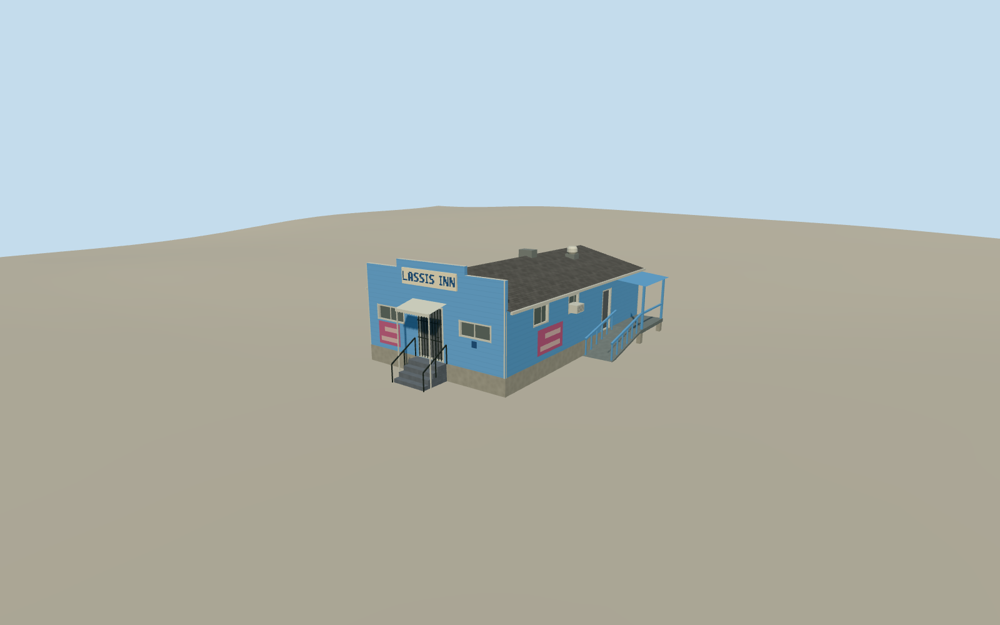

# Lassis Inn

Blue clapboard restaurant with a stepped false front, cream Lassis Inn sign, awning and concrete stairs.

Authoring state: **review-in-qa.json**. Current completion evidence is in [qa.json](qa.json) and the [completion ledger](../../../../qualla-structures/batches/qualla-003.PROGRESS.md).

- [Lassis Inn](https://qualla.com/lassis-inn/)

Four July 2024 CC0 photographs establish the stepped false front, blue siding, pale window frames, concrete steps, signs and attached side landing.

Individual roof pitches, fittings, side ramp dimensions and rear openings are approximations. The attached name uses original geometric letters. Other poster graphics are simplified.

The detached sign, surrounding lot, landscaping and street are outside the building asset. The original local elevation field is unchanged.

Build: `node content/worldgen/source/places/9y/9yn/lassis_inn/models/generate-lassis-inn.mjs`. Add `--check` to verify exact regeneration. 1427 triangles; 6 materials; no embedded photographs.
