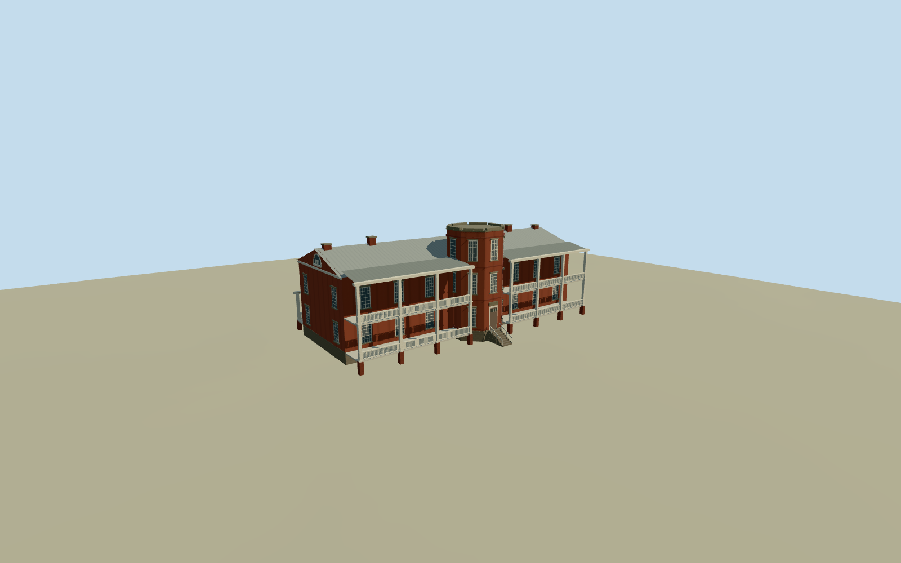

# Tower Building of the Little Rock Arsenal

The surviving Little Rock Arsenal with its crenellated octagonal brick tower, open double veranda and stone basement.

Authoring state: **review-in-qa.json**. Current completion evidence is in [qa.json](qa.json) and the [completion ledger](../../../../qualla-structures/batches/qualla-004.PROGRESS.md).

- [Tower Building of the Little Rock Arsenal](https://qualla.com/tower-building-of-the-little-rock-arsenal/)

The National Register dimensions control the hall and tower. Lesser south appendages and roof, window and porch trim details are approximate.

Build: `node content/worldgen/source/places/9y/9yn/tower_building_of_the_little_rock_arsenal/models/generate-tower-building-of-the-little-rock-arsenal.mjs`. Add `--check` to verify exact regeneration. 10200 triangles; 7 materials; no embedded photographs.
