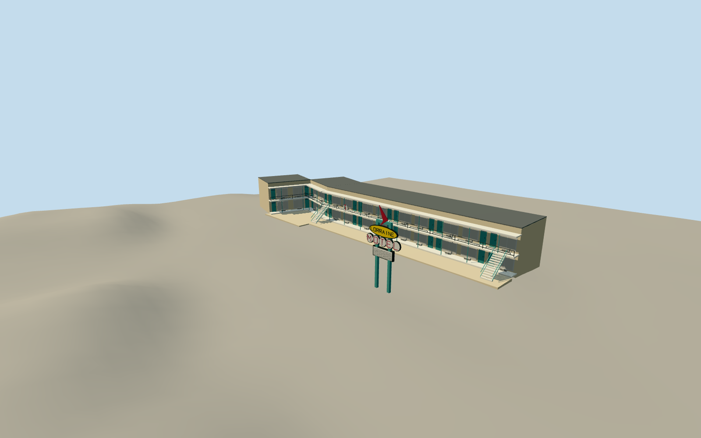

# Lorraine Motel

Preserved courtyard-facing motel frontage, angled connecting bays and short return, mint doors, cream curtains, balcony panels, room 306 wreath, exterior stairs and freestanding Googie sign.

Authoring state: **review-in-qa.json**. Current completion evidence is in [qa.json](qa.json) and the [local 100 ledger](../../../../qualla-structures/batches/PROGRESS.md).

- [Lorraine Motel](https://qualla.com/lorraine-motel/)

Original medium-fi preserved motel exterior and sign; modern museum envelope, interiors, historic cars and neighboring buildings are outside scope.

Protomaps frontage and separate balcony polygon control location and alignment. Room widths, wall depths, roof heights and sign position are photographic estimates from inspected public-domain views. The museum donor map is excluded from current imagery approval and supplies no geodetic coordinates.

Hidden rear is a simplified attachment surface. Fine sign typography, room numbers, flowers and hardware are simplified. Cleared Qualla and supporting public-domain photographs remain local reference inputs and are not embedded.

Independent coarse host terrain is retained for contact review; it is not a survey. No footprint suppression is requested for the combined museum polygon.

Build: `node packages/worldgen/scripts/generate-authored-places.mjs --ids=lorraine_motel`. Add `--check` to verify exact regeneration. 7564 triangles; 5 materials; no embedded photographs.
