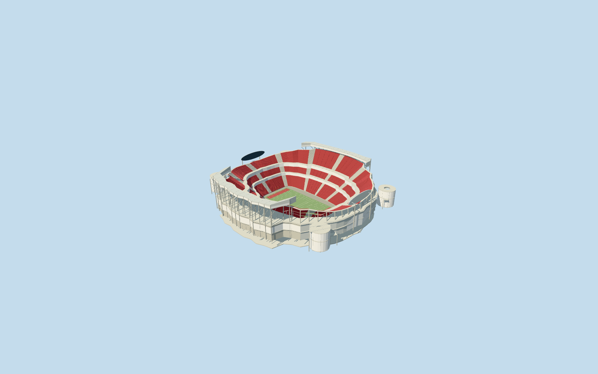

# Arrowhead Stadium

Specific existing Arrowhead Stadium in neutral NFL configuration: own native saddle-profile red bowl with lower/middle/upper banks and closed club belts, pale radial aisles, apron/green field/red end zones/neutral yard lines/yellow goal forks, two oval supported end displays and curled sideline press/gallery roofs with exposed concrete frame. White-panel end entrances with large trapezoidal glazing, four round ramp towers/open oculi/visible near helical surfaces and supported native corner access strips complete the enclosure. No copied team/sponsor lettering, logos, screen content, crowd or private texture. Detached practice facility and neighboring Kauffman Stadium remain native. Future proposed replacement/renovation and temporary soccer conversion are outside the NFL reference configuration.

## Evidence and reconstruction

Published dimensions and reconstructed details are separated in spec.json. Primary references:

- [Reference](https://populous.com/projects/arrowhead-stadium?lang=zh-hans)
- [Reference](https://commons.wikimedia.org/wiki/File:Aerial_view_of_Arrowhead_Stadium_08-31-2013.jpg)
- [Reference](https://commons.wikimedia.org/wiki/File:Arrowhead_Stadium_(October_27,_2019_-_5).jpg)

Specific existing Arrowhead Stadium in neutral NFL configuration: own native saddle-profile red bowl with lower/middle/upper banks and closed club belts, pale radial aisles, apron/green field/red end zones/neutral yard lines/yellow goal forks, two oval supported end displays and curled sideline press/gallery roofs with exposed concrete frame. White-panel end entrances with large trapezoidal glazing, four round ramp towers/open oculi/visible near helical surfaces and supported native corner access strips complete the enclosure. No copied team/sponsor lettering, logos, screen content, crowd or private texture. Detached practice facility and neighboring Kauffman Stadium remain native. Future proposed replacement/renovation and temporary soccer conversion are outside the NFL reference configuration.

## Model and axes

60,678 triangles; 182,034 vertices; 6 material groups; 7,285,252 bytes. Native bounds: -148.534, -0.600, -151.799 to 148.081, 69.500, 150.236. Source hash: `sha256:12f1f988633581f86c4752fed02ea6ba6e4861c854684b84ef2e2b09483df303`.

{"x":"east","y":"up","z":"south"}

The geographic proposal uses exact-QID OpenStreetMap evidence. Map-derived orientation and estimated architectural details require real-site visual review; preview eligibility is distinct from geographic/fidelity approval. Map attribution: © OpenStreetMap contributors, ODbL-1.0.

## Reproduce

Run `node packages/worldgen/scripts/generate-additional-landmarks.mjs --ids=arrowhead_stadium` (or add `--check`). The generator preserves manually edited masters by checking their baseline hashes. Import through the standard authored-model workflow with optimization disabled; then capture all QA cameras, including shared-surface views.

## Pending work

- Specific existing Arrowhead Stadium in neutral NFL configuration: own native saddle-profile red bowl with lower/middle/upper banks and closed club belts, pale radial aisles, apron/green field/red end zones/neutral yard lines/yellow goal forks, two oval supported end displays and curled sideline press/gallery roofs with exposed concrete frame. White-panel end entrances with large trapezoidal glazing, four round ramp towers/open oculi/visible near helical surfaces and supported native corner access strips complete the enclosure. No copied team/sponsor lettering, logos, screen content, crowd or private texture. Detached practice facility and neighboring Kauffman Stadium remain native. Future proposed replacement/renovation and temporary soccer conversion are outside the NFL reference configuration.
- Retained Q544553 and native named Arrowhead POI35184438048844 establish parent52776562721059 plus seven layered access records35185313148818/821/822/823,35185313225488/42735/42736. Only these eight stadium records are replaced. Separate pitch35184438048841 supplies113.982914x53.308355m mapped turf surround and axis; neutral NFL109.728x48.768m marked field fits within it. Native93-point outer/35-point hole control the approximately251x242m stadium envelope and lower opening. Four circular tower centres use corresponding native access-arc controls as picture-led approximations; they are not separately surveyed mapped cylinders. Anchor[-94.48400169610977,39.04892930600215]/heading0/native east-south/internal X[0.6832633811365747,0.7301720016529091]/Z[-0.7301720016529091,0.6832633811365747]. Fine20degree/2m facing, roof upturn and ramp layouts remain approximate. Independent practice/utility buildings and Kauffman Stadium are retained.
- Native stadium79m height has unqualified datum. Working fieldY0 uses original datum256.8093314766884m; lower bank1.4..17m/middle22..30m/upper36..43-59m saddle, club belts17..22/30..36m, side galleries61.5..64.2m and curled roofs65.2..69.2m are picture-led allocations. Native side sections control roof rear positions; posts/rakers connect original ground to roofs. Ramp towers use picture-estimated13.2m outer/4.8m oculus radii and original-contact first floor/28m/40m levels, four-turn near helix and layered28/40m access strips. End display oval54m wide/12m high centred54m, support heads53m, entrance glazing and goal geometry are approximate. Existing2010-renovation-era NFL shape with2013/2019 references; no later/current-condition, structural/access/optical or furnished-interior certification.
- Original standard6m Mapzen grid, roads, water and every independent building remain unchanged. Datum256.8093314766884m defines field/modelY0; own boundary samples span11.12078389705232..13.797617571080991m. Bounded opening stays within all occupied main retaining floors; separately partitioned apron/field avoid hidden overlapping caps. Circular tower first floors clear the maximum original perimeter contacts; posts, roof frame, bridge supports and display supports reach original grades. Only the eight integrated stadium records are replaced with99.5percent coverage; generalized complexes use bounded area clipping. No whole parking/precinct slab or regional terrain flattening. Failure/unload retains/restores original context.

This bundle follows the medium-fi standard. Medium-fi appearance and geographic fit are reviewed separately. Hash-bound visual acceptance is recorded separately after capture inspection.
