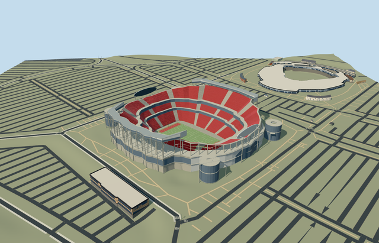

# N0733 — Arrowhead Stadium

Reviewed2026-10-20 in one author/build/inspect/fix pass.

## Appearance

Inspected48 final current source, shared-material, medium-fi and native views. Specific Arrowhead red saddle bowl/three seating banks/closed club belts/pale aisles/open NFL field and end zones/yellow goals, two supported oval end displays, curled sideline press roofs/glazed galleries/ground-contact concrete frame, white-panel end entrances/trapezoidal glazing and four circular ramp towers/open oculi/near helical surfaces/native corner access strips. Reduced only distant repetition to fit budgets during one author/build/inspect/fix pass. No copied team/sponsor artwork, lettering, crowd or furnished hidden rooms.

## Shared surfaces and browser budgets

Five existing256px graphs: concrete_plain, metal_painted, metal_standing_seam, window_grid and fabric_canvas. Concrete, painted panels/red seating/metal, roof, glazing, apron and turf share the library. Six near draws/one skyline draw; no new graph, embedded image or private atlas. Each graph read once; separate POSITION/NORMAL streams and equal CPU/GPU accounting. Shared opaque glazing is a stylistic approximation, not certified optical transmission.

| Level | Triangles | Bytes | Draws |
| --- | ---: | ---: | ---: |
| skyline | 956 | 77516 | 1 |
| district | 3704 | 323768 | 6 |
| street | 14522 | 1281332 | 6 |
| closeup | 60678 | 5663152 | 6 |

Four authored browser levels retain the saddle bowl/open field, three main banks, curled sideline roofs, oval end displays and corner towers. Fine rows, near helix, NFL marks and exposed frame appear near. Levels 956/3704/14522/60678triangles. Initial skyline plus district401284bytes, below3MB phone/6MB laptop asset targets. Physical ordinary-laptop/phone/tablet and dense-city timings remain pending.

## Approximate native placement

Retained Q544553 and native named Arrowhead POI35184438048844 establish parent52776562721059 plus seven layered access records35185313148818/821/822/823,35185313225488/42735/42736. Only these eight stadium records are replaced. Separate pitch35184438048841 supplies113.982914x53.308355m mapped turf surround and axis; neutral NFL109.728x48.768m marked field fits within it. Native93-point outer/35-point hole control the approximately251x242m stadium envelope and lower opening. Four circular tower centres use corresponding native access-arc controls as picture-led approximations; they are not separately surveyed mapped cylinders. Anchor[-94.48400169610977,39.04892930600215]/heading0/native east-south/internal X[0.6832633811365747,0.7301720016529091]/Z[-0.7301720016529091,0.6832633811365747]. Fine20degree/2m facing, roof upturn and ramp layouts remain approximate. Independent practice/utility buildings and Kauffman Stadium are retained. Production helper removes only main Arrowhead stadium and seven integrated access records. All28 independent resident records of36 originals and all50 wider independent records of58 remain unchanged, including detached practice/utility facilities and neighboring Kauffman Stadium. Original6m grid, roads and1589.3431314367335square metres source water retained. Seventeen actual PMTiles13/14/15 cases pass, including every detailed owned record and tile fragment. Generalized complexes use bounded clipping. Failure retains36 originals; every level unload restores original terrain/water/zero live model geometry. Original standard6m Mapzen grid, roads, water and every independent building remain unchanged. Datum256.8093314766884m defines field/modelY0; own boundary samples span11.12078389705232..13.797617571080991m. Bounded opening stays within all occupied main retaining floors; separately partitioned apron/field avoid hidden overlapping caps. Circular tower first floors clear the maximum original perimeter contacts; posts, roof frame, bridge supports and display supports reach original grades. Only the eight integrated stadium records are replaced with99.5percent coverage; generalized complexes use bounded area clipping. No whole parking/precinct slab or regional terrain flattening. Failure/unload retains/restores original context.

## Limits

Three ordinary photographs actually viewed: Populous renovated NFL bowl, Ichabod2013 full aerial and Kj1595 October2019 entrance. The aerial establishes independent Kauffman/practice context and four circular access towers; the entrance photo establishes white panels/trapezoidal glazing. Existing2010-renovation-era NFL shape; later temporary soccer conversion/future proposals excluded. Photos viewed only/no copied pixels. Native stadium79m height has unqualified datum. Working fieldY0 uses original datum256.8093314766884m; lower bank1.4..17m/middle22..30m/upper36..43-59m saddle, club belts17..22/30..36m, side galleries61.5..64.2m and curled roofs65.2..69.2m are picture-led allocations. Native side sections control roof rear positions; posts/rakers connect original ground to roofs. Ramp towers use picture-estimated13.2m outer/4.8m oculus radii and original-contact first floor/28m/40m levels, four-turn near helix and layered28/40m access strips. End display oval54m wide/12m high centred54m, support heads53m, entrance glazing and goal geometry are approximate. Existing2010-renovation-era NFL shape with2013/2019 references; no later/current-condition, structural/access/optical or furnished-interior certification.

## Selected checks

Six Khronos files: zero errors/warnings.1149 actual geometry/material/contact checks,48 current inspected views,17 actual native map-level cases. Selected source/import/placement/strict medium-fi/scene validation/lint pass. Sim30 hash566a418b7239ce939f4b096783a72ee90da39f8b0d87ec3d9154ecd0bfd73595.

Source sha256:12f1f988633581f86c4752fed02ea6ba6e4861c854684b84ef2e2b09483df303

Runtime sha256:d4227d6dd29fcb99f411302466968d6ac543d2af02505c86aab59a2f6ef00b6b

Input sha256:b3f23c5454abff4da62d51d82e4533f0fd90003c397dfa44c3736dfaf6dd3516

Rebuild: node packages/worldgen/scripts/generate-additional-landmarks.mjs --ids=N0733; node packages/worldgen/scripts/import-next-1000-models.mjs --ids=N0733; node packages/tooling/scripts/generate-landmark-lods.mjs --ids=N0733 --force.

## Ordinary picture references

https://populous.com/projects/arrowhead-stadium?lang=zh-hans — https://populous.com/uploads/2018/01/Arrowhead_Stadium_Populous.jpeg; Populous; individual photographer not listed; Copyright retained; viewed only, no copied pixels. Viewed only/no copied pixels.

https://commons.wikimedia.org/wiki/File:Aerial_view_of_Arrowhead_Stadium_08-31-2013.jpg — https://thumb.wikimedia.org/wikipedia/commons/thumb/a/ac/Aerial_view_of_Arrowhead_Stadium_08-31-2013.jpg/960px-Aerial_view_of_Arrowhead_Stadium_08-31-2013.jpg; Ichabod; CC-BY-SA-3.0; viewed only, no copied pixels. Viewed only/no copied pixels.

https://commons.wikimedia.org/wiki/File:Arrowhead_Stadium_(October_27,_2019_-_5).jpg — https://thumb.wikimedia.org/wikipedia/commons/thumb/c/c2/Arrowhead_Stadium_%28October_27%2C_2019_-_5%29.jpg/960px-Arrowhead_Stadium_%28October_27%2C_2019_-_5%29.jpg; Kj1595; CC-BY-SA-4.0; viewed only, no copied pixels. Viewed only/no copied pixels.
