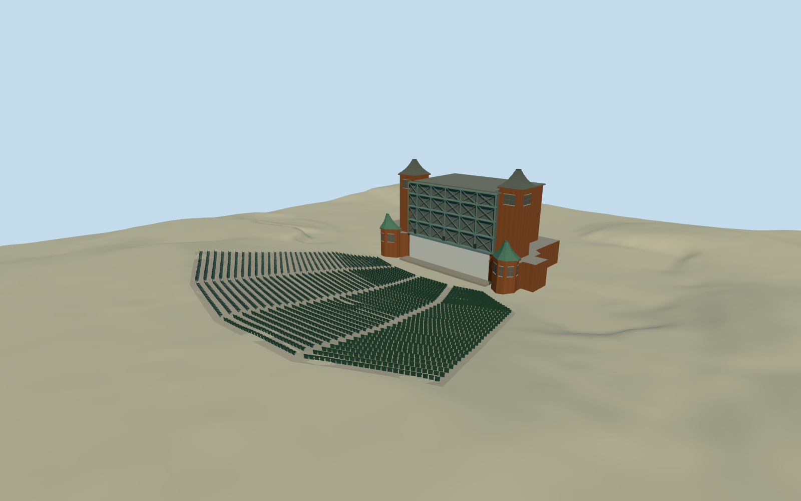

# Starlight Theatre (Kansas City, Missouri)

Swope Park’s outdoor theatre, with the four copper-roofed brick towers and the Cohen Community Stage as they stood in 2022.

Authoring state: **review-in-qa.json**. Current completion evidence is in [qa.json](qa.json) and the [completion ledger](../../../../qualla-structures/batches/qualla-004.PROGRESS.md).

- [Starlight Theatre (Kansas City, Missouri)](https://qualla.com/starlight-theatre-kansas-city-missouri/)

The exterior depicts the open-air layout evidenced in 2008 and 2022. Later light-bridge towers and canopy work are outside this historical configuration.

The outline, footprint and grading are mapped. Roof heights, brick and steel detailing, individual seats and auxiliary facilities are approximated at medium fidelity.

Build: `node content/worldgen/source/places/9y/9yu/starlight_theatre_kansas_city_missouri/models/generate-starlight-theatre-kansas-city-missouri.mjs`. Add `--check` to verify exact regeneration. 19631 triangles; 5 materials; no embedded photographs.
