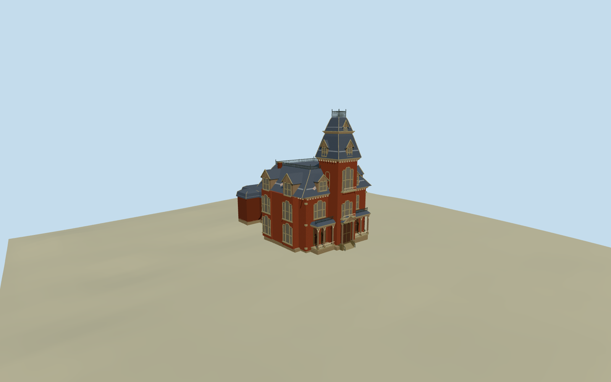

# Vaile Mansion

The Vaile Mansion in Independence, Missouri, with a slate mansard, tall center tower, veranda, and attached rear wing.

Authoring state: **review-in-qa.json**. Current completion evidence is in [qa.json](qa.json) and the [completion ledger](../../../../qualla-structures/batches/qualla-004.PROGRESS.md).

- [Vaile Mansion](https://qualla.com/vaile-mansion/)

The measured local widths come from the mapped outline. Heights and secondary projections are approximate exterior proportions inferred from the frontal and oblique archival views.

Scope includes the standing mansion and attached rear wing. Any detached greenhouse or carriage house is excluded.

Some smaller ornament and rear openings are approximate.

Build: `node content/worldgen/source/places/9y/9yu/vaile_mansion/models/generate-vaile-mansion.mjs`. Add `--check` to verify exact regeneration. 12780 triangles; 8 materials; no embedded photographs.
