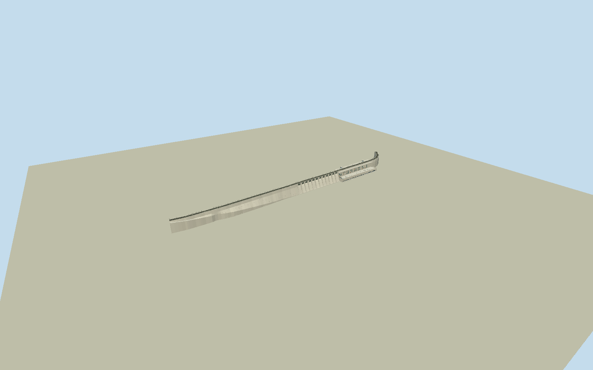

# Bagnell Dam

Whole Bagnell Dam: full775.1m licensed crest path including west359.97m and curved east100.89m retaining sections,158.50m twelve-radial-gate spillway and155.75m integral eight-unit powerhouse. Full crest two-lane road/sidewalk/parapets, battered concrete face, spillway chutes/divider piers, powerhouse tailrace outlets/flat roof/eight turbine-bay crowns and two service gantries. Represent post2018 non-overflow pier infills/new concrete surface; no2011 open supporting-pier gaps on retaining section. Exclude independent office/switchyard/pylons/WillmoreLodge/town/river/lake/naturalbank/vehicles and underground machinery. Subdued pale concrete/gray overlay, battered faces and vertical form joints, actual twelve curved closed radialgate leaves belowcrestroad, steep ribbed concrete chutes, sixteen physically open tailrace outlet arches under eight native-unitrooftopcrowns, longcream/brick intakegallery/windowband and simple metal servicegantries. Two-lane asphaltroad/openmetalfence/paleparapets. No full-height solidrectangularbox, fictitious15th/13thgate, unrelatedhydrocomplex or wholevalley slab.

Authoring state: **review-in-qa.json**. Current completion evidence is in [qa.json](qa.json) and the [completion ledger](../../../../qualla-structures/batches/qualla-002.PROGRESS.md).

- [Bagnell Dam](https://qualla.com/bagnell-dam/)

Native named dam/plantway249573944/Q14693496 supplies all17unique outlinevertices/18closedpositions and eight independently mapped generator centres. Whole crest follows native road527179353, bounded by federal FERC2007 four-section lengths: west1181ft, spillway520ft, powerhouse511ft, curved east331ft, total2543ft/775.1064m. Zero station is native spillway-west transition vertex14 projected onto actual crestroad; section boundaries/retaining endpoints interpolated along the mapped road. Native polygon covers roughly620m of lower concrete footprint and does NOT by itself represent both full retaining crests; no stretching that polygon to775m. Native crest endpoints/curvature and all17lower-outline controls retained, full fixedanchor[-92.62539458081129,38.20327815433034],heading0.6247155361171215 before terrain orgeometry; +X NE alongdam/+Z SE downstream. Profile/heights/retaining-toe taper/roof/outlet arch and ornamental census are medium-fi photographic architectural estimates.

Fullfour-section775.106mcrest/12closedradialgates/eightnativegeneratorbaycrowns andintegralpowerhouse represented. Tailraceoutlets use16deepphysicalarchedrecesses(two perunit) atdetailedlevels/eightmergedrecessesatskyline, simplifieddarkengine-roomclosures; actualhiddenoutletinternalcensus approximate. Publishedwhole2011ownCC0aerial suppliesarchitecture; primaryowner2018text supplies newretainingupperinfills/overlay. Gatesclosed/nonoperable; no hydrologic simulation or plantinterior.

FERC148ft/45.1104m maximum is abovebedrock, not45mabovevisible tailwater. Exteriorcrest31.2m/normalpoolabout28m/0mtoe/powerhouseroof11.8m/retainingbanktoe27m/uppergallery28m/gantry36.9m are architecturalestimates independent of frozenDEM. Buriedfoundation/riverbed notinvented as measured. Upperinfills are solidconcrete basedonownertext; exactpost2018surfacejointlocations/crownhardware/windows/railcensus/roofmachinery approximate.

One exactpublishedKTrimble2011ownCC0wholeaerial individuallyinspected/nativeSHA1bound, originalnamedfirst-person selfrelease preserved; unchangedpublishedpolicy passes. No supplementalphoto needed; uncertain/attribution/historicNARAphoto pixels notused. FERC/ownerprotectedPDFimages/plans notviewed/adopted; textfacts only. No media/body/category/imagerypolicy edits, photo textures/downloaded mesh/generated bitmap.

Independent1024m129square8m16641samplefield/fourrawTerrariumtiles frozenbeforegeometry; sourcegrid/PNG/tiles unchanged, providerdownstreamdatum172.378m not actualchart/survey. Sourcegroundcuts onlyunderphysicalnativeconcrete/retainingextensions, sourcevaluesneverflattened/fitted/reacquired. Portableflatstage is for isolatedgeometry; contextretainsindependentDEM. Ordinarygeographicpreview/replacementdisabled; actualhost/footing contact unverified.

Independentoffice/switchyard/transmissiontowers/WillmoreLodge/town/banks/river/lake/water/vehicles/boats/people/interiorhydraulicmachinery excluded. Twoauxiliary internalunits inFERCtext do not become tenmainrooftopgeneratorbays.

Build: `node packages/worldgen/scripts/generate-authored-places.mjs --ids=bagnell_dam`. Add `--check` to verify exact regeneration. 23826 triangles; 5 materials; no embedded photographs.
