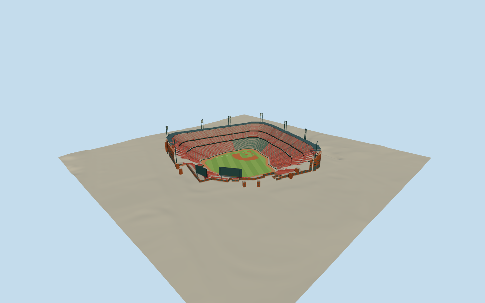

# Busch Stadium

Busch Stadium in St. Louis is a red-brick ballpark with an open northeast outfield and three red seating decks beneath a narrow steel canopy.

Authoring state: **review-in-qa.json**. Current completion evidence is in [qa.json](qa.json) and the [completion ledger](../../../../qualla-structures/batches/qualla-003.PROGRESS.md).

- [Busch Stadium](https://qualla.com/busch-stadium/)

Deck and roof heights, the Eads Bridge-inspired entrance span, chosen seating subdivisions, and details in areas outside the cleared photos are estimates.

The stadium sits on an original composite terrain field. The playing surface is below the west entry, and the approximate field plane is based on the interior source heights.

Build: `node content/worldgen/source/places/9y/9yz/busch_stadium/models/generate-busch-stadium.mjs`. Add `--check` to verify exact regeneration. 25763 triangles; 6 materials; no embedded photographs.
