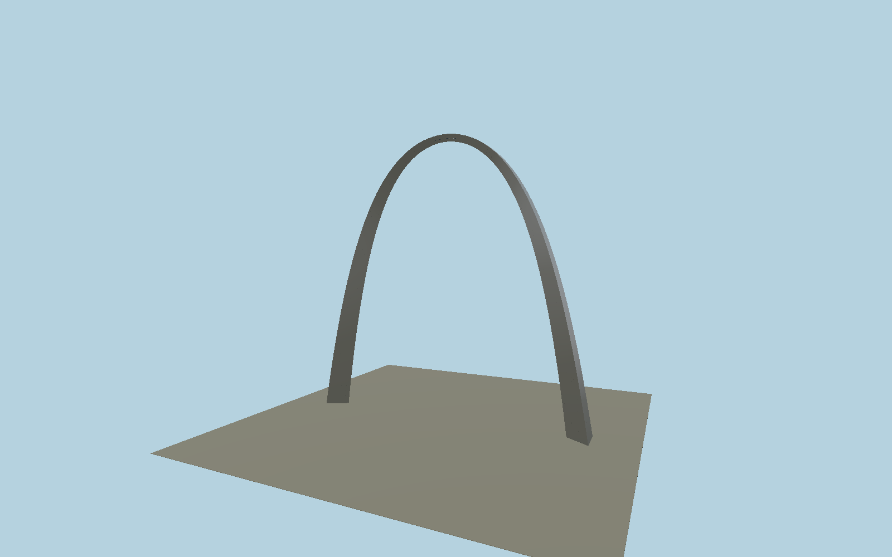

# Gateway Arch

Weighted catenary shell with equilateral triangular sections, separate steel faces, longitudinal shop welds, field station welds, 32 recessed observation ports and crown service hatch. Entirely editable metric geometry with a shared brushed-stainless surface.

## Identity and geometry

Catalog gateway_arch, [Q2027162](https://www.wikidata.org/wiki/Q2027162). NPS published centroid equation and section dimensions. Surface reconstruction yields 192.024 m height and approximately 192.025 m width without independent scaling. Ground plane clips the sloped foot sections.

Ground-level midpoint between the two leg centroids. +X points north-northeast along the leg axis, about17°east of north; +Z points east-southeast; ports face the east-southeast and west-northwest sides; +Y is up. The geographic proposal identifies its anchor and orientation evidence separately from remaining terrain and azimuth uncertainty.

Source facts and measured references are recorded in spec.json. References: [1](https://home.nps.gov/jeff/planyourvisit/mathematical-equation.htm), [2](https://home.nps.gov/jeff/planyourvisit/gateway-arch-fact-sheet.htm), [3](https://www.nps.gov/jeff/planyourvisit/architecture.htm), [4](https://npshistory.com/publications/jeff/hsr-gateway-arch-v1.pdf), [5](https://www.nps.gov/jeff/planyourvisit/gateway-arch.htm). Reference pages and images are not redistributed.

## Original source and shared materials

Geometry is authored in `packages/worldgen/scripts/gateway-arch-model.mjs`. Shared material graphs with metric repeat UV0 and original vertex tints; GLB PBR fallback remains self-contained. No per-model texture duplication. No third-party mesh or photograph is embedded.

50,314 triangles; 122,967 vertices; 2 material groups; 5,032,464 source bytes. Source hash: `sha256:f2e47a0db5fb4403c14993ae5cb0c0c92c7c3d846340b6be3f14f1cd6e9d6b7d`. Geometry validation checks finite Float32 coordinates, indices, triangle area and winding before export.

Regenerate with `node packages/worldgen/scripts/generate-heritage-towers.mjs gateway_arch`; add `--check` for reproducibility. The generator refuses to overwrite a master whose hash differs from source.json. Import uses `--no-optimize` to preserve facade recesses.

## Remaining detail and review

- Complete static medium-fi exterior of the Gateway Arch itself: NPS weighted catenary, equilateral triangular taper, both ground-clipped steel feet, three outer faces,32 recessed observation ports and low crown service hatch. The unchanged50314triangle detailed source master remains reproducible. Skyline is a complete128-segment catenary with triangular faces; district retains all32 actual port holes/reveals and street adds simplified shop and field welds; closeup retains the full detailed geometry. Weld station locations, port station offsets and service-hatch sizes remain photographic reconstructions. NPS fact-sheet27inch port width and HSR approximate24inch clear width differ and remain explicitly recorded. The two below-grade leg exit courts, visitor/museum building, underground interior, ramps and wider landscaped park are separate site architecture outside this steel-arch asset. GroundY0 is the upper steel-foot contact datum, not the lower exit court. Four mapped outer-foot corners constrain a rigid rotation/translation with no scaling; maximum residual below3m and2° heading tolerance acknowledge map generalization. OSM relation12813920 incorrectly carries the park Q45234; identity uses exactQ2027162 node4004558403, supported by the named steel-arch relation and observed feet. Common brushed-stainless graph approximates finish; local oil-canning, staining and individual weld condition are not duplicated. Absolute site elevation, live host terrain and physical phone/laptop timings remain unmeasured.

Named near/far cameras are included for lit visual review. A valid export is not maximum-fidelity certification.
