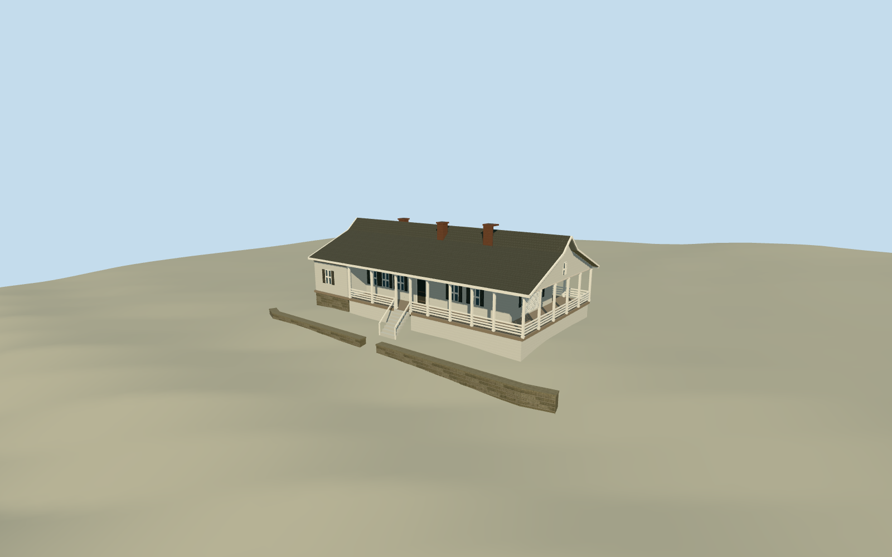

# Green Tree Tavern (Janis-Ziegler House)

The Nicolas Janis House in Ste. Genevieve, with raised wraparound galleries, a flared roof, walnut construction, and a limestone street wall.

Authoring state: **review-in-qa.json**. Current completion evidence is in [qa.json](qa.json) and the [completion ledger](../../../../qualla-structures/batches/qualla-004.PROGRESS.md).

- [Green Tree Tavern (Janis-Ziegler House)](https://qualla.com/green-tree-tavern-janis-ziegler-house/)

The site bearing is taken from the north-oriented measured site plan. Historic millwork, weathering and the stone grade break are simplified to the available photographic and survey detail.

Build: `node content/worldgen/source/places/9y/9yz/green_tree_tavern_janis_ziegler_house/models/generate-green-tree-tavern-janis-ziegler-house.mjs`. Add `--check` to verify exact regeneration. 7178 triangles; 7 materials; no embedded photographs.
