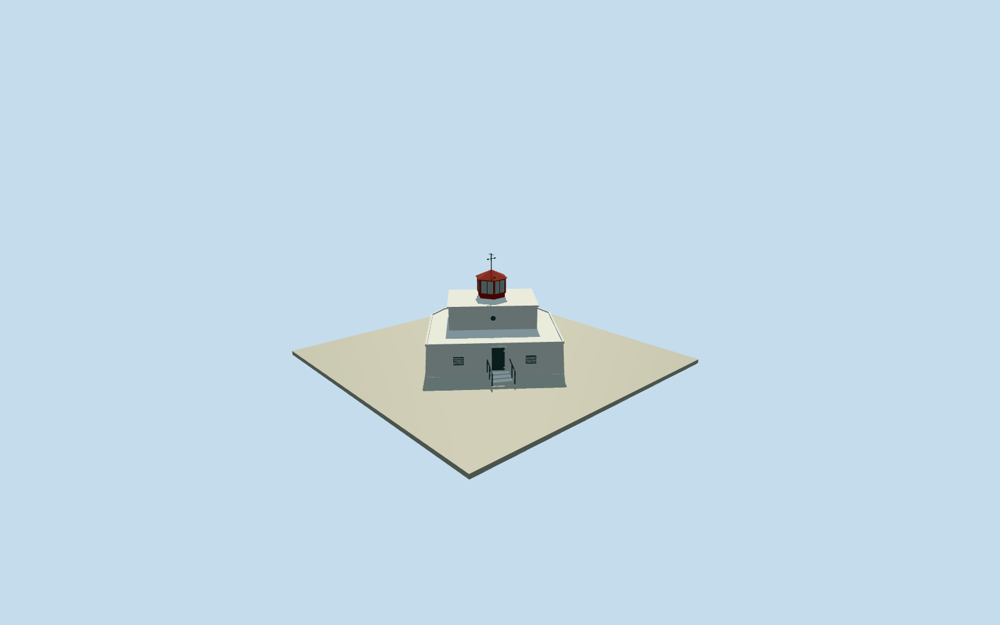

# Amphitrite Point Lighthouse

Low broad white concrete lighthouse/service building on its complete native D-shaped footprint: gently battered lower wall, setback flat-roof upper storey with a small physical vent, short red hexagonal glazed lantern and hipped roof/weather mast, and recessed landward door with intrinsic short approach steps/handrails. Detached station, helipads, fence, trail and rocky landscape excluded.

Authoring state: **review-in-qa.json**. Current completion evidence is in [qa.json](qa.json) and the [completion ledger](../../../../qualla-structures/batches/qualla-002.PROGRESS.md).

- [Amphitrite Point Lighthouse](https://qualla.com/amphitrite-point-lighthouse/)

The full original named lighthouse way374651008/Q28375578 controls its irregular D-shaped lower plan, anchor and true-east orientation. Original attached footway fixes entrance/approach; neighboring station buildings and helipads are distinct objects. The native15mseamark light-height is a focal elevation above sea level, not a15mstructural height.

One exact Qualla-published448x336TourismUcluelet2008PD-selforiginal controls broad low white massing, narrower upper storey, red lantern/hip roof, weather mast and access-step typology. About6mprimarystructure height, upper setbacks, glazing sections, slight wall batter, vents/door and small fittings are medium-fi photographic estimates; the image has limited detail. No attribution/share-alike alternative or supplemental photograph was used.

Exterior assembly only. Lantern panes are restrained opaque glazing for portable appearance; internal optics, inscriptions, electrical/meteorological equipment and hidden fittings are not engineering reconstructions. Fine mullions/vent slats/weather fittings retire in lower LODs. Detached station/helipads, fence, Wild Pacific Trail, cliff rock/landscape and former wooden lighthouse excluded.

Footings extend.35m below a fixed original approach datum and a short own-entry stair rises.28m. Exact rocky foundation and terrain/step contact remain approximate; source terrain is preserved and no whole-rock platform or blanket ground opening is introduced.

Build: `node packages/worldgen/scripts/generate-authored-places.mjs --ids=amphitrite_point_lighthouse`. Add `--check` to verify exact regeneration. 1128 triangles; 3 materials; no embedded photographs.
