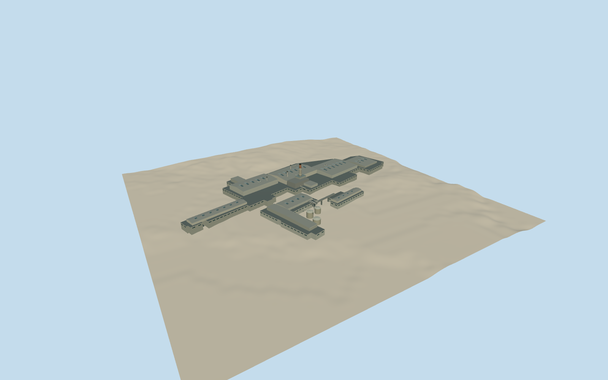

# Port Alberni Mill

The Port Alberni waterfront paper mill with long stepped industrial sheds, a boiler stack, rooftop vents and separate processing blocks.

Authoring state: **review-in-qa.json**. Current completion evidence is in [qa.json](qa.json) and the [completion ledger](../../../../qualla-structures/batches/qualla-003.PROGRESS.md).

- [Port Alberni Mill](https://qualla.com/port-alberni-mill/)

Current individual bay heights, colors, roof divisions and equipment placements are estimated. The 1970 image predates later processing changes and does not establish present equipment count.

One tall common boiler stack and representative smaller vents illustrate the documented later process layout. The model does not reconstruct vanished Kraft lines or the historic log-boom yard.

The three named mapped industrial buildings are the model scope. Outlying buildings, clarification ponds, shore handling and interiors remain outside it.

Build: `node content/worldgen/source/places/c0/c0z/port_alberni_mill/models/generate-port-alberni-mill.mjs`. Add `--check` to verify exact regeneration. 5572 triangles; 5 materials; no embedded photographs.
