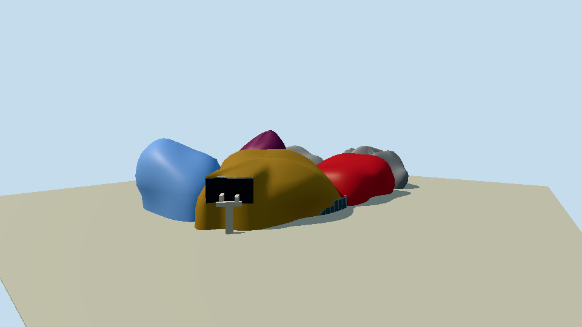

# Museum of Pop Culture, Seattle — A05

Frank Gehry's 2000 Museum of Pop Culture (built as the Experience Music Project): a cluster of undulating sheet-metal masses on the mapped building parts, each clad in its own color of stainless steel or painted aluminum shingles: the tall rose-purple Sky Church crown in the middle, sky blue to the southwest, gold to the southeast, red along 5th Avenue North and rippling silver at the north end; the Seattle Center Monorail's twin concrete guideways pass through the building between the blue and gold masses; glazed entrances on the Seattle Center and 5th Avenue sides.



Built by `content/worldgen/source/places/c2/c22/a05_museum_of_pop_culture_seattle/models/generate-museum-of-pop-culture.mjs` with the shared emitter
`packages/worldgen/scripts/place-master-emitter.mjs`: 12125 triangles,
5 materials, no embedded bitmaps. The runtime asset is `molen.worldgen.structure.a05_museum_of_pop_culture_seattle`; its runtime
levels come from the landmark LOD generator after import.

## Frame

`footprint.json` holds the mapped outlines this recipe follows, already in the model frame: +X
along heading 0 rad from the anchor [-122.3482378, 47.6214968], +Y up from the
ground there (34.95 m). The placement in
`content/earth/source/placements` uses the same anchor and heading.

## Dimensions

- Plan: the mapped OSM building 35184533676574 (way 161587742, MoPOP) and its seven parts 35185906997820-35185906997826; each part is one colored mass (footprint.json)
- Part colors as mapped: 1534908988 maroon (h 22, tallest, the purple Sky Church crown), 1534908989 and 1534908990 silver (h 20), 1534908991 #6495ED blue (h 20), 1534908992 and 1534908993 red (h 19, 18), 1534908994 gold (h 19) (https://www.openstreetmap.org/way/1534908988)
- 140,000 sq ft on a 35,000 sq ft footprint; highest point 85 ft at the Sky Church; widest 210 ft at W Harrison St; 360 ft long on 5th Ave N; about 3,000 panels of 21,000 stainless steel and painted aluminum shingles (https://www.mopop.org/building)
- Purple, gold and silver skins are stainless steel; red and blue skins are painted aluminum; curved steel ribs carry the skin (https://special.seattletimes.com/o/special/emp/bldg/cons20.html)
- The Sky Church is the purple-skinned central tower (https://www.thestranger.com/news/its-a-bird-its-a-plane-4134/)
- Monorail guideways: OSM ways 505897789 and 916411048 (tunnel=building_passage) through the building; beams 3 ft wide by 5 ft deep, about 20 ft clear underneath (https://en.wikipedia.org/wiki/Seattle_Center_Monorail)

## Limitations

- Each mass is a smooth lofted shell over its mapped outline with an estimated profile, lean and crown ripple; the real crumpled folds, fins and shingle courses are not modelled, and crown heights follow the mapped part heights above local ground (the Sky Church crown is set to the published 85 ft).
- Colors are the mapped part colors matched to published finishes; the iridescent shift of the stainless skins is a single tint per mass.
- The monorail passage is shown as twin beams on two T-pylons with dark tunnel mouths where the mapped passage meets the skin; beam height is estimated from the published 20 ft clearance. Trains are not part of the model.
- Entrance glazing, the glass canopy and interior spaces are simplified or omitted.
- Original deterministic geometry from mapped footprints, published dimensions and general knowledge of the building; not a survey, photogrammetric reconstruction or replica of any third-party model. No photographs or generated bitmaps are embedded.

## Rebuild

```sh
node content/worldgen/source/places/c2/c22/a05_museum_of_pop_culture_seattle/models/generate-museum-of-pop-culture.mjs          # add --check to verify
```
