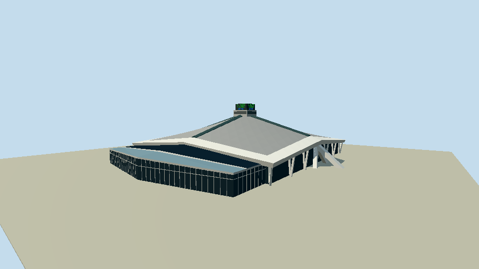

# Climate Pledge Arena, Seattle — A07

The 1962 Washington State Coliseum roof preserved over the 2021 arena: a 400 ft square hyperbolic-paraboloid roof in four pale standing-seam quadrants between two dark cardinal truss ridges rising to the apex monitor and its Climate Pledge Arena signs; a broad white concrete edge beam sloping from each facade's centred three-legged abutment down to the low corners; the recessed glass curtain wall under the overhang with V-shaped piers; and the 2021 glass-and-solar south atrium.



Built by `content/worldgen/source/places/c2/c22/a07_climate_pledge_arena_seattle/models/generate-climate-pledge-arena.mjs` with the shared emitter
`packages/worldgen/scripts/place-master-emitter.mjs`: 6488 triangles,
6 materials, no embedded bitmaps. The runtime asset is `molen.worldgen.structure.a07_climate_pledge_arena_seattle`; its runtime
levels come from the landmark LOD generator after import.

## Frame

`footprint.json` holds the mapped outlines this recipe follows, already in the model frame: +X
along heading -0.008117 rad from the anchor [-122.353991, 47.622099], +Y up from the
ground there (34.71 m). The placement in
`content/earth/source/placements` uses the same anchor and heading.

## Dimensions

- Plan: the mapped OSM building 35184397212588 with its roof part 35184783610349 (the 123 x 124 m square), glass base 35185724736644, truss strips 35185724754940-943, apex monitor 35184783610363, abutment legs 35185724755821-823 and south atrium parts 35185724736639-643 (footprint.json)
- Hyperbolic paraboloid roof over a 400-foot-square column-free hall 115 feet high; post-tensioned concrete edge beams; four massive concrete abutments and V-shaped concrete piers (https://www.seattle.gov/documents/Departments/economicDevelopment/KeyArena_Nomination_170330.pdf)
- Four sets of three-legged abutments, one centred on each facade, carry the external edge beams and four triangular steel main trusses oriented to the cardinal directions; the glass curtain wall is recessed behind them beneath the overhanging roof; standing-seam aluminium roofing since 1995 (https://www.seattle.gov/documents/Departments/economicDevelopment/KeyArena_Nomination_170330.pdf)
- 12-foot-deep main trusses divide the 400-foot square into four quadrants on buttresses at the midpoints of each wall; diagonal trusses follow the drape of the original cable net; edge beams 30 feet wide (https://www.djc.com/special/design95/10002590.htm)
- Roof 110 feet (11 stories) high on four massive concrete abutments, 4-acre site (https://pcad.lib.washington.edu/building/5972/)
- 2018-2021 redevelopment kept the 44-million-pound roof, curtain wall and exterior concrete elements; the roof was carried on temporary steel while the arena was excavated below it; south atrium added for the entrance (https://www.thorntontomasetti.com/project/climate-pledge-arena)

## Limitations

- Roof heights are estimated: the apex from the 110-115 ft published height, the facade midpoints and low corners (about 13 m and 8 m above the plaza) from aerial photographs showing each facade edge falling from its abutment to the corners. The plaza datum is taken 3.5 m above the anchor because the explorer ground under the building is flattened to the arena floor.
- Each roof quadrant is an exact bilinear hyperbolic paraboloid on a 16 x 16 grid; the diamond seam pattern, gutters and rooftop equipment are omitted.
- The curtain wall is one glass face per bay with full-height mullions and two transoms; its alternating angled lites and the 1995 lower-level entrances are not modelled. The edge beam is a sloped fascia with a flat soffit.
- The south abutment and the curtain wall inside the 2021 atrium are omitted; the atrium roof is simplified to solar and glazed bands on two folded planes.
- Rooftop signs are block channel letters on a simple frame; the apex monitor is a plain louvered box.
- Original deterministic geometry from mapped footprints, published dimensions and general knowledge of the building; not a survey, photogrammetric reconstruction or replica of any third-party model. No photographs or generated bitmaps are embedded.

## Rebuild

```sh
node content/worldgen/source/places/c2/c22/a07_climate_pledge_arena_seattle/models/generate-climate-pledge-arena.mjs          # add --check to verify
```
