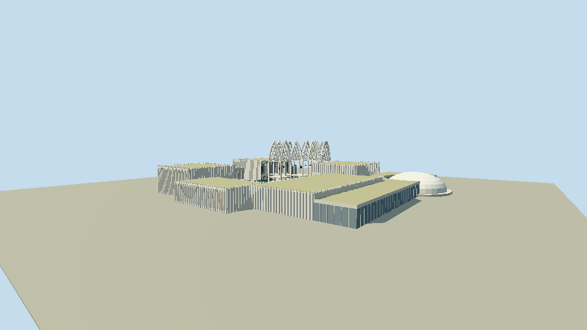

# Pacific Science Center, Seattle — A10

Minoru Yamasaki's 1962 United States Science Pavilion: six brilliant-white precast concrete buildings in a U around a courtyard of two-level reflecting pools with petalled fountains, their walls screens of 5 ft ribbed panels with pointed 'space gothic' lancet arches and rib tips above the parapets (open arcades on the courtyard porches); five 100 ft open-ribbed lattice arch towers stand offset on the two-level entry walkways over the upper pool; the 1996 Discovery Labs, the 1998 IMAX dome and the glass Ackerley gallery close the north corners.



Built by `content/worldgen/source/places/c2/c22/a10_pacific_science_center_seattle/models/generate-pacific-science-center.mjs` with the shared emitter
`packages/worldgen/scripts/place-master-emitter.mjs`: 22558 triangles,
5 materials, no embedded bitmaps. The runtime asset is `molen.worldgen.structure.a10_pacific_science_center_seattle`; its runtime
levels come from the landmark LOD generator after import.

## Frame

`footprint.json` holds the mapped outlines this recipe follows, already in the model frame: +X
along heading -0.005291 rad from the anchor [-122.351111, 47.619167], +Y up from the
ground there (44.54 m). The placement in
`content/earth/source/placements` uses the same anchor and heading.

## Dimensions

- Plan: the mapped OSM building 35184767044735 (way 394955903) and its parts 35184767044715, -719, -714, -730, -722, -731 (the six 1962 buildings), -708, -726, -710, -709 (1990s additions) (footprint.json)
- Building sizes: NW and NE buildings 105 x 120 ft, 50 ft high; Laser Dome 105 x 100 ft, 50 ft; west building 175 x 85 ft, 32 ft; east building 225 x 115 ft, 32 ft; south building 62.5 x 128.75 ft, two storeys on the slope (https://pauldorpat.com/wp-content/uploads/2023/05/2010-02-26-LPBCurrentNomPacScienceCtrrevised722010.pdf)
- Walls of prestressed precast ribbed panels 5 ft wide and 32-50 ft tall, faced in white quartzite aggregate; arched panels carry a central rib 2 ft above the parapet; scalloped infill panels elsewhere (https://pauldorpat.com/wp-content/uploads/2023/05/2010-02-26-LPBCurrentNomPacScienceCtrrevised722010.pdf)
- Five precast concrete 100 ft entry arches topped with open-ribbed vaults on ten 40 x 40 ft slabs (entry level and lower exit level), each carrying a pendant light on cable cross-ties, centred on the Seattle Center north-south axis (https://pauldorpat.com/wp-content/uploads/2023/05/2010-02-26-LPBCurrentNomPacScienceCtrrevised722010.pdf)
- Two-level shallow reflecting pool, the north half about 2 ft above the south; eight petalled fountains (three upper, five lower); 1993 pool pad and walk across the lower pool; raised viewing platform north of the south building (https://pauldorpat.com/wp-content/uploads/2023/05/2010-02-26-LPBCurrentNomPacScienceCtrrevised722010.pdf)
- Pools, fountains and walks: OSM natural=water 1464047117, amenity=fountain 394955860-394955868, highway=pedestrian 56629867 (tower platform chain) (https://www.openstreetmap.org/way/56629867)
- Five 100-foot towers with open-ribbed space gothic arches; 475 vertical panels; Yamasaki first planned a single 110 ft tower (https://pacificsciencecenter.org/?p=551)

## Limitations

- Tower arch springing, lattice spacing and rib sizes are estimated from photographs; the published height (100 ft) is used, not the 110 ft of the abandoned single-tower scheme.
- Panel tracery is reduced to ribs with one pointed lancet head per 5 ft bay per tier; scalloped panels are ribs only; the curved ribs under the walkway slabs, railings, benches and planters are omitted.
- The upper pool outline is inferred from the mapped walks and fountains (OSM maps only the lower pool); pool and walkway levels are estimated relative to the courtyard paving.
- The 1990s additions (Discovery Labs, IMAX dome, Ackerley gallery) are simple glass and white masses on their mapped outlines; ticket kiosks and the south entrance bay are omitted.
- Original deterministic geometry from mapped footprints, published dimensions and general knowledge of the building; not a survey, photogrammetric reconstruction or replica of any third-party model. No photographs or generated bitmaps are embedded.

## Rebuild

```sh
node content/worldgen/source/places/c2/c22/a10_pacific_science_center_seattle/models/generate-pacific-science-center.mjs          # add --check to verify
```
