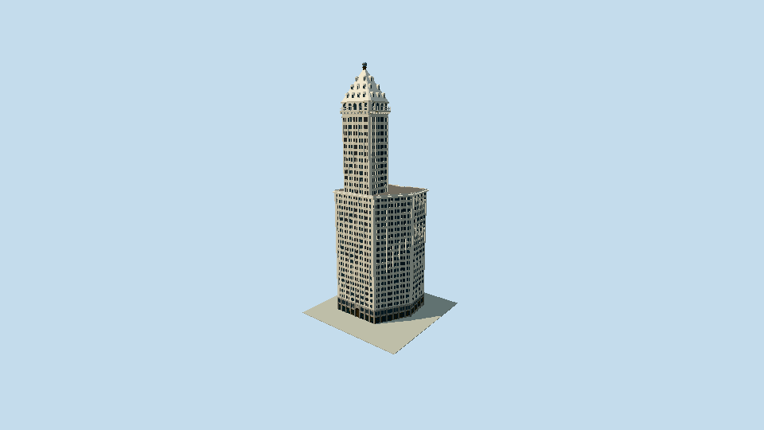

# Smith Tower, Seattle — A02

Seattle's 1914 white terra-cotta skyscraper at Second Avenue and Yesler Way: a 21-storey base block over a two-storey granite plinth with storefronts and a round-arched entrance, heavy cornices, and a slender chamfered shaft rising flush with the Second Avenue front in a pier-and-spandrel grid to the 35th-floor observation balcony with its white steel cage, crowned by a steep terra-cotta pyramid with three tiers of small arched dormers, a bronze collar, the glass globe and a finial.



Built by `content/worldgen/source/places/c2/c23/a02_smith_tower_seattle/models/generate-smith-tower.mjs` with the shared emitter
`packages/worldgen/scripts/place-master-emitter.mjs`: 10482 triangles,
7 materials, no embedded bitmaps. The runtime asset is `molen.worldgen.structure.a02_smith_tower_seattle`; its runtime
levels come from the landmark LOD generator after import.

## Frame

`footprint.json` holds the mapped outlines this recipe follows, already in the model frame: +X
along heading -1.03411 rad from the anchor [-122.3318661, 47.6019531], +Y up from the
ground there (13.42 m). The placement in
`content/earth/source/placements` uses the same anchor and heading.

## Dimensions

- Plan: mapped OSM base 35184424870493 (75 m) and tower part 35184790229218 (141 m), with the crown parts 35184790229216 and 35184790229217 at its centre; the shaft is 20.0 m along Second Avenue by 15.7 m with chamfered corners (footprint.json)
- 38 floors; 140.8 m (462 ft) architectural height to the top of the pyramid, 147.5 m (484 ft) to the tip; observatory at 119.5 m (392 ft) (https://www.skyscrapercenter.com/building/wd/9676)
- 462 ft to the top of the pyramid per the permit plans; a mounted tower with a broad base and a slender shaft; heavy cornices; pyramid with three tiers of small arched windows and a hollow glass globe on top; observation deck and function room on the 35th story with a balcony whose masonry balusters were replaced by a cage of white-painted steel bars (https://www.historylink.org/File/4310)
- Lower part 236 ft (22 stories, including the attic), tower an additional 20 stories; Washington granite on the first two floors and terra cotta above; light courts begin at the third floor; bronze window sash (https://pcad.lib.washington.edu/building/4149)
- Granite skin on the first and second floors, terra cotta on the rest; crowned by an 8-foot (2.4 m) glass globe (https://en.wikipedia.org/wiki/Smith_Tower)

## Limitations

- Floor heights are a uniform 3.43 m above the two-storey plinth, fitted so the 35th floor lands near the published observatory height; the base cornice and attic are estimated from photographs.
- Terra-cotta ornament (capitals, lion and Indian heads, cartouches) is reduced to piers, spandrel bands, mullions and stepped cornices; window sash is not modelled.
- Bay counts (five on the long shaft faces, four on the short) and the dormer counts per tier are estimated; the pyramid is a straight-sided pyramid over the chamfered shaft plan.
- The base follows the mapped outline, including its two shallow light-court notches; the alley and party walls carry the same grid above the plinth and no ground-floor openings.
- Original deterministic geometry from mapped footprints, published dimensions and general knowledge of the building; not a survey, photogrammetric reconstruction or replica of any third-party model. No photographs or generated bitmaps are embedded.

## Rebuild

```sh
node content/worldgen/source/places/c2/c23/a02_smith_tower_seattle/models/generate-smith-tower.mjs          # add --check to verify
```
