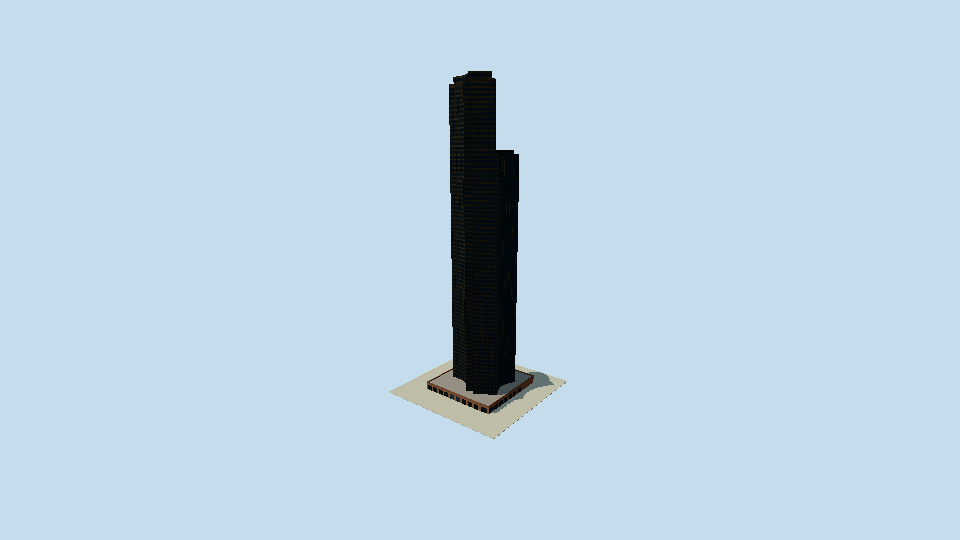

# Columbia Center, Seattle — A03

Seattle's tallest building (1985): three interlocking shafts of near-black smoked glass banded by dark metal spandrels, each with one concave face (west at 280 m, southeast at 223 m, northeast at 160 m) stepping down around one another, with setback crowns, on a three-storey Carnelian granite podium that fills the steep block between Fourth and Fifth Avenues, with the Fourth Avenue lobby and canopy and the Fifth Avenue plaza entrance under the northeast face.



Built by `content/worldgen/source/places/c2/c23/a03_columbia_center_seattle/models/generate-columbia-center.mjs` with the shared emitter
`packages/worldgen/scripts/place-master-emitter.mjs`: 11980 triangles,
6 materials, no embedded bitmaps. The runtime asset is `molen.worldgen.structure.a03_columbia_center_seattle`; its runtime
levels come from the landmark LOD generator after import.

## Frame

`footprint.json` holds the mapped outlines this recipe follows, already in the model frame: +X
along heading -1.010161 rad from the anchor [-122.3306682, 47.604531], +Y up from the
ground there (42.23 m). The placement in
`content/earth/source/placements` uses the same anchor and heading.

## Dimensions

- Plan: mapped OSM parts 35184790221357 (280 m) with its crown 35184790221349 (286 m), 35184790221352 (223 m) with its crown 35184790221347 (226 m), 35184703382703 (160 m) and the podium 35184479213120 (14 m); heights stand on the Fourth Avenue sidewalk (footprint.json)
- 76 floors above ground; architectural height 284 m (933 ft), roof 286 m (937 ft); three concave facades with two setbacks so it reads as three towers side by side; base clad in Rosa Purino Carnelian granite; Fifth Avenue is higher than Fourth and Cherry Street beside it slopes 17.1% (https://en.wikipedia.org/wiki/Columbia_Center)
- Three large arcs placed back to back, facing west, south and east toward Elliott Bay, Mount Rainier and the Cascades; dark coloration; the block bounded by Fourth and Fifth Avenues, Columbia and Cherry Streets (https://pcad.lib.washington.edu/building/4218/)
- Three curved volumes with their concave facades facing outward, each a different height; dark glass with dark metal spandrels giving a subtle horizontal stripe; the three lower levels clad in pink granite (https://buildingsdb.com/WA/seattle/columbia-center/)
- Clad in smoked tempered glass and Carnelian granite; dark, concave facade enhanced by setbacks (https://skyrisecities.com/news/2016/10/seattles-granite-king-views-columbia-center.23274)

## Limitations

- Segment heights are the mapped part heights over the Fourth Avenue sidewalk (5 m under the anchor); the published 284/286 m top is within 2 m of the crown here. Rooftop equipment and the 295 m tip are not modelled.
- Plan curves follow the mapped outlines (about 0.3 m tile precision), with smoothed normals on the curved glass; the setback crowns are the mapped inner parts.
- The curtain wall is one glass face per wall with a spandrel band per 3.68 m storey; vertical mullions (about 1.5 m apart, under the closeup error) are not drawn.
- The podium deck height, its window bays, the Fourth Avenue canopy and the Fifth Avenue entrance are estimated; the podium deck is drawn as plain paving and the underground concourse is omitted.
- Original deterministic geometry from mapped footprints, published dimensions and general knowledge of the building; not a survey, photogrammetric reconstruction or replica of any third-party model. No photographs or generated bitmaps are embedded.

## Rebuild

```sh
node content/worldgen/source/places/c2/c23/a03_columbia_center_seattle/models/generate-columbia-center.mjs          # add --check to verify
```
