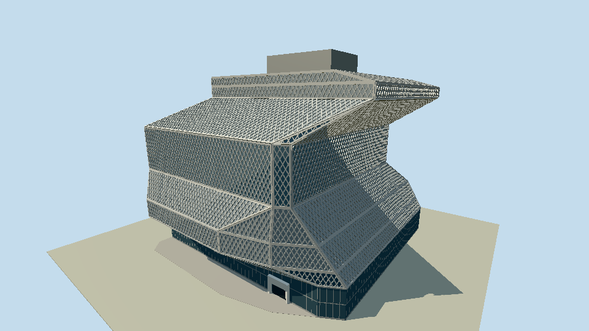

# Seattle Central Library — A04

The 2004 OMA/LMN Central Library on the block between Fourth and Fifth Avenues, Madison and Spring Streets: a stack of shifted platforms wrapped in one faceted skin of glass under a light diamond steel grid. Two-storey storefront and a covered plaza under the cantilevered meeting platform on Fourth Avenue, the sloping living-room roof falling to Fifth Avenue, the books-spiral box cantilevered over Spring Street, the reading-room slopes, and the headquarters platform cantilevered over Fifth Avenue and Madison Street, with the core penthouse on the roof.



Built by `content/worldgen/source/places/c2/c23/a04_seattle_central_library/models/generate-seattle-central-library.mjs` with the shared emitter
`packages/worldgen/scripts/place-master-emitter.mjs`: 20847 triangles,
7 materials, no embedded bitmaps. The runtime asset is `molen.worldgen.structure.a04_seattle_central_library`; its runtime
levels come from the landmark LOD generator after import.

## Frame

`footprint.json` holds the mapped outlines this recipe follows, already in the model frame: +X
along heading -1.008773 rad from the anchor [-122.333052, 47.606623], +Y up from the
ground there (49.19 m). The placement in
`content/earth/source/placements` uses the same anchor and heading.

## Dimensions

- Plan: the mapped OSM building 35184409145274 (the block outline, with its chamfered corners) and its roof parts 35184830292122/26/28/31, which show the flat headquarters roof and the reading-room slopes toward Spring Street, Fourth Avenue and Madison Street (footprint.json)
- 11 storeys, 185 ft (56.4 m) to the roof, 362,987 sq ft; address 1000 Fourth Avenue on the block bounded by Fourth and Fifth Avenues and Madison and Spring Streets; level 1 faces Fourth Avenue, level 3 faces Fifth Avenue (https://en.wikipedia.org/wiki/Seattle_Central_Library)
- Diamond grid 4 ft wide by 7 ft tall (4 ft on a side); nearly 10,000 diamonds over about 130,000 sq ft of curtain wall; platforms from bottom to top: staff, living room, meeting, mixing chamber, four-level books platform, reading room, one-storey headquarters cantilevering up to 28 ft; 213 ft concrete core in the southwest quadrant (https://enr.com/articles/29464-seattle-146-s-eccentric-145-book-behemoth-146-shatters-stereotypes)
- Diamonds 7 ft tall at their tallest and 4 ft wide at their widest; the Fourth Avenue entrance sits beneath a large cantilevered section; the grade change between the entrances fits a staff level between the two public floors (https://homepages.bluffton.edu/~SULLIVANM/washington/seattle/library/northandwest.html)
- Platforms cantilever up to 52 ft; a diamond steel grid ties the platform trusses together and carries the curtain wall (https://www.mka.com/projects/seattle-central-library/)
- Level 3 living room along Fifth Avenue reaches 50 ft in height; Books Spiral on levels 6 through 9 (https://spl.org/hours-and-locations/central-library/central-library-highlights/central-library-architecture)

## Limitations

- Platform heights and plan offsets are read from street photographs (the Fifth Avenue elevation and the views from Fourth and Madison and Fifth and Spring) and the mapped roof parts; they are estimates, not survey levels.
- Every skin plane spans straight between two platform edges, so the folds are simplified: the V-shaped plane under the books platform at Fourth and Madison, the sloped columns at the Fifth and Spring corner and the headquarters bevel toward Madison Street are approximations.
- Glass is clear, mesh-laminated (light) or seen from below per plane; the scattered opaque diamonds and the interior (red floor, yellow escalators, books spiral) are not modelled.
- The explorer terrain has a 5-9 m pit over this block that reaches about 25 m east of Fifth Avenue, so the level 3 Fifth Avenue entrance (modelled at real grade, 9.3 m above Fourth Avenue) can stand above the drawn street there.
- Original deterministic geometry from mapped footprints, published dimensions and general knowledge of the building; not a survey, photogrammetric reconstruction or replica of any third-party model. No photographs or generated bitmaps are embedded.

## Rebuild

```sh
node content/worldgen/source/places/c2/c23/a04_seattle_central_library/models/generate-seattle-central-library.mjs          # add --check to verify
```
