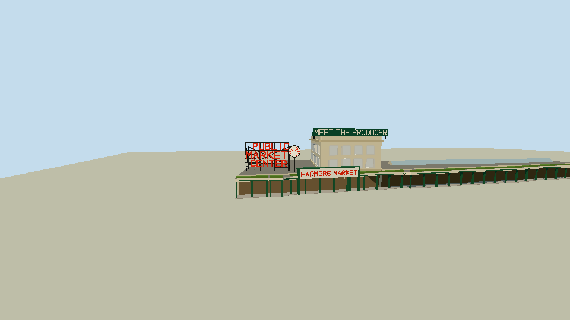

# Pike Place Market, Seattle — A06

Pike Place Market at the foot of Pike Street: the Main Arcade and North Arcade along the west side of Pike Place as one low storey of open stalls under a sidewalk canopy with green cast-iron posts, cream fascia and planters, with glazed roof monitors; the corner arcade with the red neon PUBLIC MARKET CENTER sign and its clock on a steel frame, the FARMERS MARKET entrance band, the three-storey cream building with the green MEET THE PRODUCER board; and the bay side falling four more storeys down the bluff toward Western Avenue, cream walls with rows of white-framed industrial windows and the painted PIKE PLACE MARKET name.



Built by `content/worldgen/source/places/c2/c23/a06_pike_place_market_seattle/models/generate-pike-place-market.mjs` with the shared emitter
`packages/worldgen/scripts/place-master-emitter.mjs`: 14361 triangles,
8 materials, no embedded bitmaps. The runtime asset is `molen.worldgen.structure.a06_pike_place_market_seattle`; its runtime
levels come from the landmark LOD generator after import.

## Frame

`footprint.json` holds the mapped outlines this recipe follows, already in the model frame: +X
along heading 2.421472 rad from the anchor [-122.341194, 47.608963], +Y up from the
ground there (34.06 m). The placement in
`content/earth/source/placements` uses the same anchor and heading.

## Dimensions

- Plan: mapped OSM buildings 35185643742633 (Main Arcade), 35185647971802 (its Pike Place sidewalk bay), 35185647971799 (corner arcade at Pike Street), 35184603446492 and 35185643742632 (south blocks), 35184603446491 (North Arcade); ground at each vertex falls 12-16 m from Pike Place to the Western Avenue side (footprint.json)
- Main Arcade built 1907 at the foot of Pike Street on the west side of Pike Place, North Arcade 1911; the market drops several floors down the bluff toward Western Avenue (Down Under); the Public Market Center sign and clock, among the first neon signs in Seattle, date from the 1930s (https://en.wikipedia.org/wiki/Pike_Place_Market)
- Sign layout (PUBLIC over MARKET over CENTER, clock to the right of PUBLIC and MARKET on an open steel frame on the corner arcade roof) and the FARMERS MARKET and MEET THE PRODUCER signs, from street photographs looking west down Pike Street (https://commons.wikimedia.org/wiki/File:Public_Market_Center_sign_at_Pike_Place.jpg)
- West (Western Avenue) facade: cream walls with rows of large white-framed multi-pane windows, five levels, painted Pike Place Market lettering (https://commons.wikimedia.org/wiki/File:Pike_Place_Market_from_Western_Avenue_in_Seattle.jpg)

## Limitations

- Heights are estimated from photographs: arcade roofs 4.8 m above Pike Place, the canopy at 3.75-4.5 m, the MEET THE PRODUCER building three storeys, the sign about 7.5 m tall and 13 m wide with a 3.5 m clock. Pike Place is modelled level along each arcade (the North Arcade 1.9 m lower).
- The Economy Market, Corner Market, Sanitary Market and the other buildings east of Pike Place, the MarketFront and the parking garage on Western Avenue are separate mapped buildings and are not part of this model.
- Lettering uses block capitals (the painted name on the bay side is mixed case in reality); the clock has bars instead of numerals; stall fronts, produce tables and the flags along the roof are reduced to a dark storefront band.
- The explorer terrain carries a few metres of noise along the bluff edge here (a mound inside the south end of the Main Arcade), so the sidewalk grade under the canopies can differ from the modelled level by up to about 2-3 m.
- Original deterministic geometry from mapped footprints, published dimensions and general knowledge of the building; not a survey, photogrammetric reconstruction or replica of any third-party model. No photographs or generated bitmaps are embedded.

## Rebuild

```sh
node content/worldgen/source/places/c2/c23/a06_pike_place_market_seattle/models/generate-pike-place-market.mjs          # add --check to verify
```
