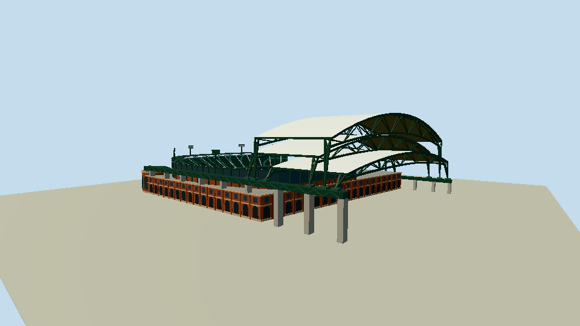

# T-Mobile Park, Seattle — A08

Retro ballpark on its SoDo block: a horseshoe of dark-green seat bands wrapping home plate in the south-west corner and the first- and third-base lines, a sun canopy and light towers on the upper deck, left-field bleachers under the big scoreboard, natural grass with a red-brown infield opening north-east toward downtown, a red-and-blond brick facade with arched bays and the home-plate rotunda, and the three-panel retractable roof parked open over the railway on exposed dark-green tri-chord trusses, tripod legs and its north and south runways.



Built by `content/worldgen/source/places/c2/c23/a08_t_mobile_park_seattle/models/generate-t-mobile-park.mjs` with the shared emitter
`packages/worldgen/scripts/place-master-emitter.mjs`: 19669 triangles,
9 materials, no embedded bitmaps. The runtime asset is `molen.worldgen.structure.a08_t_mobile_park_seattle`; its runtime
levels come from the landmark LOD generator after import.

## Frame

`footprint.json` holds the mapped outlines this recipe follows, already in the model frame: +X
along heading 0 rad from the anchor [-122.3325, 47.591389], +Y up from the
ground there (4.93 m). The placement in
`content/earth/source/placements` uses the same anchor and heading.

## Dimensions

- Plan: mapped OSM building 52776561141580 (outer ring), stands 35185823923355, steps 35185823923340-52, left-field bleachers 35185823923344, parked roof 35185823923353/54 and runways 35185823923342/43; field, warning track and infield from the mapped pitch and sand polygons (footprint.json)
- Field: 331 ft left, 401 ft centre, 326 ft right, natural grass; home-plate entry rotunda at First Avenue South and South Atlantic Street (the south-west corner) (https://en.wikipedia.org/wiki/T-Mobile_Park)
- Roof: three panels, panels 1 and 3 span 631 ft and panel 2 655 ft; 217 ft clear at second base with the centre panel highest, highest truss 275 ft; south runway 100 ft high, north runway 50 ft, lower to keep downtown views; tri-chord trusses with triangular downturned legs on eight-wheel trucks (https://www.djc.com/special/safeco/10053886.htm)
- Retractable roof of about 9 acres stacks over the BNSF tracks east of the ballpark, partly over the right-field stands; skewed 8 degrees to suit the field (https://en.wikipedia.org/wiki/T-Mobile_Park)
- Exposed steel painted dark green; facade of red and blond brick; four main entrances at the corners; home-plate rotunda (https://portal.djc.com/special/safeco/10053885.htm)
- Centre-field scoreboard 56.7 ft high by 201.5 ft wide (2013); bleachers above left field below it (https://pcad.lib.washington.edu/building/4552)

## Limitations

- Home plate, foul lines (5.5 deg off the grid) and the infield are fitted to the mapped infield sand; stand rakes, deck heights (lower bowl to 12 m, upper deck 20.5-35 m, canopy 39 m) and the bleacher level are estimated from the mapped heights and photographs.
- Seat tiers are stepped bands of about 1.1 m per row with aisle strips; concourses, suites, the Pen, bullpens and signage are reduced to plain masses, glazing and a dark screen.
- The parked roof is an interpretation: panel widths (62-66 m), stacking order and offsets are fitted to the mapped roof outline and the 8 deg skew; trusses are drawn as a few members per bay, and the runways as box girders with face lattice.
- The brick facade repeats one arched-bay rhythm on every side; gate canopies, team-store fronts and the parking garage south of Edgar Martinez Drive are not modelled.
- Original deterministic geometry from mapped footprints, published dimensions and general knowledge of the building; not a survey, photogrammetric reconstruction or replica of any third-party model. No photographs or generated bitmaps are embedded.

## Rebuild

```sh
node content/worldgen/source/places/c2/c23/a08_t_mobile_park_seattle/models/generate-t-mobile-park.mjs          # add --check to verify
```
