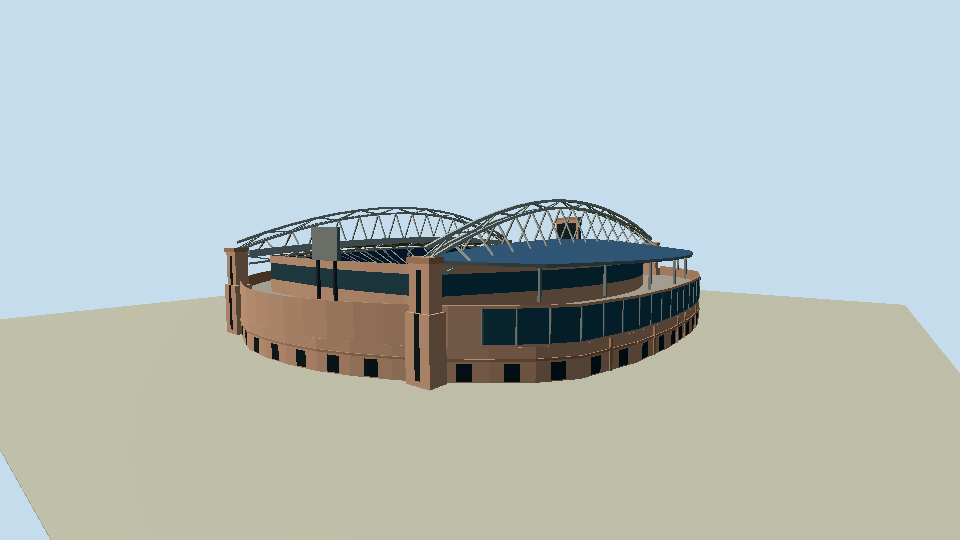

# Lumen Field, Seattle — A09

U-shaped football and soccer stadium on its SoDo site: a ring of grey-blue seat bands round the green turf, club glazing and a steep cantilevered upper deck on the sidelines and the south end, an open north end toward downtown with the Hawks' Nest bleachers and the scoreboard tower, two long lens-shaped blue roofs over the sideline stands each carried by a light steel tied arch springing between concrete corner pylons, and a salmon-concrete masonry base with red brick on the west and a glass curtain wall on the east.



Built by `content/worldgen/source/places/c2/c23/a09_lumen_field_seattle/models/generate-lumen-field.mjs` with the shared emitter
`packages/worldgen/scripts/place-master-emitter.mjs`: 19318 triangles,
10 materials, no embedded bitmaps. The runtime asset is `molen.worldgen.structure.a09_lumen_field_seattle`; its runtime
levels come from the landmark LOD generator after import.

## Frame

`footprint.json` holds the mapped outlines this recipe follows, already in the model frame: +X
along heading 0 rad from the anchor [-122.331667, 47.595278], +Y up from the
ground there (5.19 m). The placement in
`content/earth/source/placements` uses the same anchor and heading.

## Dimensions

- Plan: mapped OSM bowl 52776560439079 (outer edge and pitch hole), roofs 35184830296938/39 (= buildings 35185007241382/83), Hawks' Nest part 35184830296935 and north tower 35184830296944 (60 m) (footprint.json)
- Roof covers about 70% of the seats and leaves the field open; 720 ft span between concrete pylons at the north and south ends; two arches rise about 200 ft over the field; painted blue in 2010 (https://en.wikipedia.org/wiki/Lumen_Field)
- Tied-arch roof: a lower tri-chord truss and a steel arch of 16 A-frame components acting together, on friction-pendulum bearings in the pylons (https://www.bdcnetwork.com/nurturing-community)
- 85 ft masonry base of stained concrete and concrete masonry; 56 ft upper-bowl cantilever over the suite level; U-shaped bowl open to the north toward downtown (https://www.bdcnetwork.com/nurturing-community)
- Salmon-coloured concrete exterior, red brick on part of the west side, glass curtain wall on the east; 13-storey north tower with a vertical scoreboard above the Hawks' Nest; FieldTurf surface (https://en.wikipedia.org/wiki/Lumen_Field)

## Limitations

- Seat rakes, deck heights (lower bowl to 12 m, upper deck 20.6-37 m), the roof deck levels (39-46 m) and the arch crown (about 62 m) are estimated from the mapped 36 m roof height, the 200 ft arch figure and photographs.
- Seat tiers are stepped bands of about 1.1-1.8 m per row with aisle strips; suites, concourses and the Toyota fan deck are reduced to glazing, decks and plain masses.
- The roof deck is one sloped surface per side on the mapped lens outline; the tied arch, its tri-chord tie and the A-frame hangers are a few members per bay. Painted lettering and lights on the roof are omitted.
- The north tower video board and the south-end board are plain dark screens of estimated size; the separate Event Center and garage to the south are not part of this model.
- Original deterministic geometry from mapped footprints, published dimensions and general knowledge of the building; not a survey, photogrammetric reconstruction or replica of any third-party model. No photographs or generated bitmaps are embedded.

## Rebuild

```sh
node content/worldgen/source/places/c2/c23/a09_lumen_field_seattle/models/generate-lumen-field.mjs          # add --check to verify
```
