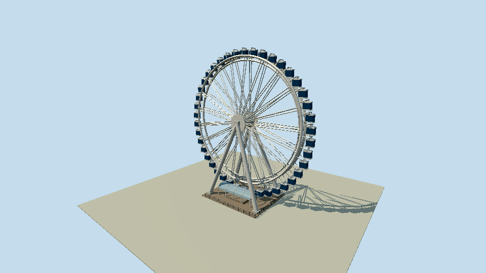

# Seattle Great Wheel — A11

The white 175 ft (53 m) observation wheel at the end of Pier 57, standing perpendicular to the waterfront and overhanging Elliott Bay: a twin-chord rim with 42 enclosed navy-glass gondolas hanging outside it, crossed spokes from a long hub with round white covers, two splayed A-frames carrying the axle, a white-ribbed glass boarding canopy, and the timber pier-end deck on piles.



Built by `content/worldgen/source/places/c2/c23/a11_seattle_great_wheel/models/generate-seattle-great-wheel.mjs` with the shared emitter
`packages/worldgen/scripts/place-master-emitter.mjs`: 9888 triangles,
5 materials, no embedded bitmaps. The runtime asset is `molen.worldgen.structure.a11_seattle_great_wheel`; its runtime
levels come from the landmark LOD generator after import.

## Frame

`footprint.json` holds the mapped outlines this recipe follows, already in the model frame: +X
along heading -2.709898 rad from the anchor [-122.3424999, 47.6061669], +Y up from the
ground there (4.96 m). The placement in
`content/earth/source/placements` uses the same anchor and heading.

## Dimensions

- Frame: the mapped glass-roofed base 35184768695710 (OSM way 396606878, building=roof) under the OSM attraction=big_wheel node 1809238334 (height 53); wheel plane along the base outline, about 245/65 deg azimuth; Pier 57 shed 35184538999531 for context (footprint.json)
- Overall height 175 feet (53.3 m); 42 climate-controlled enclosed gondolas of up to eight passengers; extends 40 feet (12.2 m) out over Elliott Bay; opened June 29, 2012 at Pier 57, 1301 Alaskan Way (https://en.wikipedia.org/wiki/Seattle_Great_Wheel)
- Wheel plane faces Colman Dock and the Space Needle line (seen face-on from the ferry approach and from the Pier 58/59 overlook, edge-on along the pier) (https://commons.wikimedia.org/wiki/Category:Seattle_Great_Wheel)

## Limitations

- Rim, pivot-circle and hub dimensions (45 m rim, 50 m gondola circle, hub 28.5 m above the deck) are estimated from the published overall height and photographs; the lattice spokes are single tubes and the rim truss is two chords with ties.
- Gondolas are drawn hanging plumb at every station; the glass-floored VIP gondola, LED lighting and the maintenance stair on one leg are omitted.
- The boarding canopy and platforms are simplified; the pier-end deck, piles and railings stand in for the platform the wheel occupies beyond the mapped Pier 57 shed. Deck top is 0.25 m above the anchor ground, which is the pier deck level in the explorer elevation.
- Original deterministic geometry from mapped footprints, published dimensions and general knowledge of the building; not a survey, photogrammetric reconstruction or replica of any third-party model. No photographs or generated bitmaps are embedded.

## Rebuild

```sh
node content/worldgen/source/places/c2/c23/a11_seattle_great_wheel/models/generate-seattle-great-wheel.mjs          # add --check to verify
```
