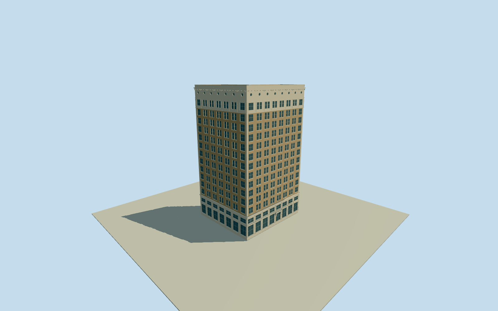

# Alaska Building

Preserved Seattle corner skyscraper with exact native base perimeter, pale two-level terra-cotta base, buff-brick paired-window shaft, ornate pale capital/rectangular sash and round attic windows, bracketed Second Avenue entrance and flat L-shaped roof/open estimated rear court. Clear published1909Qualla book scans and municipal preservation facts control exterior; inner court/hidden hotel brace and minor roof sections approximate.

Authoring state: **review-in-qa.json**. Current completion evidence is in [qa.json](qa.json) and the [completion ledger](../../../../qualla-structures/batches/qualla-002.PROGRESS.md).

- [Alaska Building](https://qualla.com/alaska-building/)

Exact native named Alaska Buildingway240874271/Q4708507 supplies original six-vertex full base plan and62mheight. Original Cherry Street edge and perimeter mean establish heading/anchor; story point and neighboring footprints do not replace these controls.

Both accepted images are already-published Qualla native mechanical scans of1909publications with explicit PD-scan/PD-1923primary records and nativeSHA1matches. GeneralHistorypage66shows full corner facades/capital/base; AsahelCurtis1908parade in Argus1909shows southeast side/step-back. Historic awnings/flags/lettering/parade/traffic and all hotel branding/artwork are excluded. No copied photograph or generated bitmap texture.

Municipal text documents preserved original windows, buff brick/pale terra cotta, two-level base, eleven-row shaft and L-shaped upper plan. Precise rear-court position/width/roof levels and hidden2010seismic brace are not surveyed or photographically resolved. Rear court is an explicitly estimated notch behind both intact photographed street facades. Official74x50ftfootprint and southwest-court wording conflict with native plan/primary elevations and are not adopted as exact controls.

Native14levels and other15floor conventions differ with basement/attic. Two base rows, eleven shaft rows, rectangular capital and small porthole row form a bounded photographic exterior section within62m. Exact ornament, window census, contemporary storefront/roof services and concealed structure are medium-fi estimates; no interior or engineering replica claim.

Independent180mrawTerrariumfield and fixed dry Second Avenue datum remain unchanged, with1.3mdeep base. Uphill street, basement/sidewalk threshold and host-DEM attachment are approximate. No terrain flattening, fitted grade, generic site platform, neighboring building or landscape included.

Build: `node packages/worldgen/scripts/generate-authored-places.mjs --ids=alaska_building`. Add `--check` to verify exact regeneration. 25187 triangles; 4 materials; no embedded photographs.
