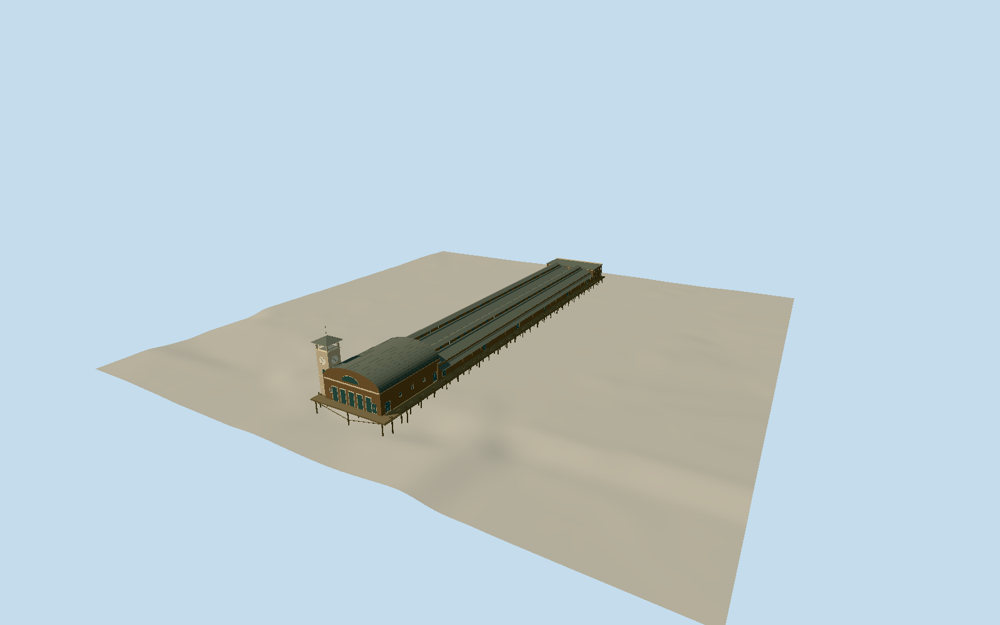

# Colman Dock (1911)

Whole1908-1911ColmanDock steamship terminal at footofColumbiaStreet: full approximately705ft timberpier/independentpilebents/fenders/cargoapron, two longconnectedcargo sheds with clerestories/awnings/doors, shoreoffice/shopfront, domedwesternwaitingroom and iconic northwestclocktower/fourclocks/openlookout/hiproof/flagstaff. Dated1911 reconstruction; no current2023terminal/Pier50/GrandTrunkDock/ColmanBuilding/boats/streets/cardart.

Authoring state: **review-in-qa.json**. Current completion evidence is in [qa.json](qa.json) and the [completion ledger](../../../../qualla-structures/batches/qualla-002.PROGRESS.md).

- [Colman Dock](https://qualla.com/colman-dock/)

Primary CityofSeattle historicwaterfrontsurvey text identifies1908westextension705ft, domedwaitingroom and clocktower on northwestcorner/fourclockfaces, followedby1912destruction. Whole historical pier length214.884m;35.052m width inferred from later115ft dock record and postcard proportions, not measured1911survey. Present ColumbiaStreet shoreapproachnode12233211727/ways1321962095+775170043 give shorevicinity; inferred duewest pier axis heading-PI/2, +Zwest/+Xsouth and midpoint anchor[-122.33841351819422,47.6024507]. Historicshoreedge/centreline/bearing may differ by tensofmetres; actual historicfootprint notmapped. Current2023terminal outline notused as1911shape. Picturedroof/window/clock/pile/office dimensions are bounded medium-fi estimates; source postcard is hand-coloured.

Historic intrinsic pier deck6m above fixed openbay provider reference, chosen before geometry; piles to fixed-10m below providerwaterreference, not a seabed survey. Independentmoderncoastalfield retained, includingmodernreclaimedgroundandstructures; not1911tidal/pavement reconstruction. No sourceflattening/fitting/reacquisition or footprint shift toclear currentground. Oldverticalgrade/deckfreeboard/seabed/hostcontact unverified, datedonlyplacement.

Whole dated1911 terminal/pier, not just clocktower and notcurrent2023terminal. Pierwidth/shoreposition/duewestbearing/longshed layout, room/dome sections, office/shopfront, openingcensus/clerestories, pilings/bents/fenders and roof/clock/rail hardware are medium-fi inferences from publishedpostcards/text, not architecturalsurvey. Hiddenrearandconnectiondetails approximate; ships/GrandTrunkDock/Pier50/independentColmanBuilding/cardart excluded.

Two individually inspected exact published ca1910LowmanHanford and1911MitchellUS-expiredpostcards/nativePD-US/grants/SHA1/revisions bound. Same underlyingfacade view/negativefamily, no claim of independentfullcoverage. ModernCCviews andunknowncreator/damaged-terminal images unused; no supplementalphotos/photographictextures/generatedbitmaps/borrowedmeshes.

Independent256m129square16641-sample moderncoastalfield andoriginalrawtile frozenbeforegeometry, with fixed offshoreprovider reference. Deck6m/piletoe-10m are intrinsic structural estimates; sourcegroundnotflattened/fitted/reacquired and not1911tidal/grade/seabedsurvey. Dated1911placement only, currentworldexcluded and hostground/watercontactunverified.

FourLODs preservewholepier/twosheds/shoreoffice/domedwaitingroom/NWclocktower/fourclockfaces/openlookout/hiproof/flagstaff. Nearcargo openings/windowreveals/mullions/clerestories/coveredwalk posts/piles/bents/fenders/clockticks/lookoutrails restored progressively.

Build: `node packages/worldgen/scripts/generate-authored-places.mjs --ids=colman_dock`. Add `--check` to verify exact regeneration. 23180 triangles; 6 materials; no embedded photographs.
