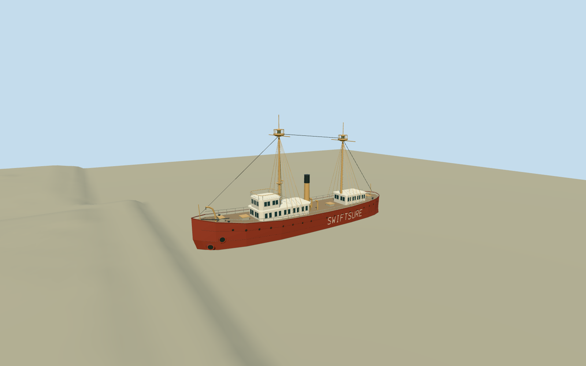

# United States lightship Swiftsure (LV-83)

The preserved red steel and timber lightship with twin yellow beacon masts and a black-topped funnel at Seattle’s Historic Ships Wharf.

Authoring state: **review-in-qa.json**. Current completion evidence is in [qa.json](qa.json) and the [completion ledger](../../../../qualla-structures/batches/qualla-004.PROGRESS.md).

- [United States Lightship Swiftsure (LV-83)](https://qualla.com/united-states-lightship-swiftsure-lv-83/)

Exterior only. Restored appearance follows the clear museum-era reference views. Temporary deck-restoration covers and neighboring ships are omitted.

Riveting, rigging and fittings are simplified by distance. Submerged hull shape is interpretive from the original lines plan and capped below the normal waterline.

The mooring is fixed. Actual lake level and temporary vessel moves vary.

Build: `node content/worldgen/source/places/c2/c23/united_states_lightship_swiftsure_lv_83/models/generate-swiftsure.mjs`. Add `--check` to verify exact regeneration. 8074 triangles; 5 materials; no embedded photographs.
