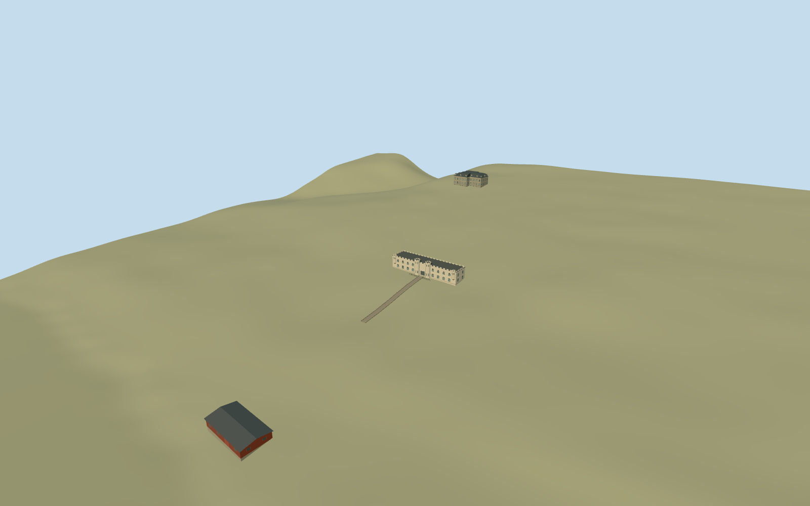

# British Columbia Penitentiary

Surviving British Columbia Penitentiary exteriors: the Gothic Gatehouse and stair, the stone mansard-roofed Gaol Block and the red Wharf Warehouse.

Authoring state: **review-in-qa.json**. Current completion evidence is in [qa.json](qa.json) and the [completion ledger](../../../../qualla-structures/batches/qualla-003.PROGRESS.md).

- [British Columbia Penitentiary](https://qualla.com/british-columbia-penitentiary/)

The model covers three surviving exteriors and the ceremonial stair. Most of the former prison was demolished after 1980. The original demolished wings, prison walls, burial ground and interiors are outside the scope.

Heights, small facade divisions, facade material colors, mansard and warehouse roof framing and stair landings are estimated from written and geographic evidence.

The original terrain sets the approach and warehouse grade. Nearby river surface, railway, streets and private properties are supplied by the surrounding Earth context.

Build: `node content/worldgen/source/places/c2/c28/british_columbia_penitentiary/models/generate-british-columbia-penitentiary.mjs`. Add `--check` to verify exact regeneration. 11822 triangles; 6 materials; no embedded photographs.
